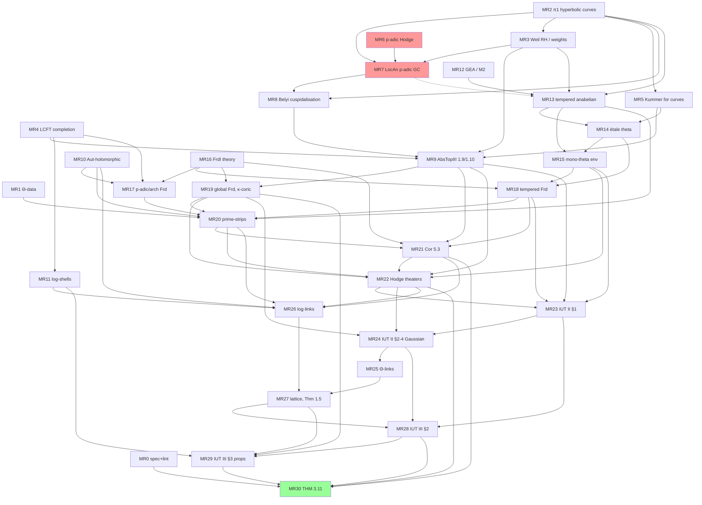

# ROADMAP — the full multiradial algorithm of IUT III, Theorem 3.11, with no interfaces and no shells

*Draft of 2026-10-14. Written by a session-2 research subagent. Read-only survey; no repository was changed.*

**Basis.**
- **iut:** the worktree `~/iut-wt-s2` at `2de72de`. That is `origin/main` `43e1e54` plus one pin bump of local-class-field-theory to `e7e2ff3`.
- **Dependency packages:** `~/iut-wt-s2/.lake/packages/*` at the pins of `lake-manifest.json`.
- **lana-agents repos:** `origin/main` heads read with `git ls-remote`.
- **Paper texts:** the local text files listed in Appendix A. Every statement number below was looked up in these texts. Where a text is not available, this is said explicitly.

**Placement.** `session2-instructions.md` (UPDATE 17) asks for this file at `~/iut/Iut/Multiradial/ROADMAP.md`, committed to main. This draft is in `~/iut-scratch/multiradial/ROADMAP.md`, as the subagent brief required. Moving and committing it is left to the session lead.

**Goal (Christian, Zulip #609).** "we should now focus on formalising the full multiradial algorithm of 3.11. formalise it completely, no interfaces, no shells. formalise all of the papers and all the required prerequisites." Zulip #612 adds: reuse and extend the lana-agents repositories.

---

## 0. Executive summary

1. **What exists.** We have IUT III Thm 3.11 as a theorem *about a model*. We do not have the algorithm. In `Iut/LogLink`, all of 3.11(i)–(iii) and 1.5(v) hold "in the model" (`thm311_full_model`). But the inputs of that model are local fields, number fields, and data records standing for strips, Kummer isomorphisms, coric strips and mono-theta environments. Two consequences:
   - the "algorithm output" is hard-coded as `lgp D S` (`HodgeTheater/Wall.lean:91`);
   - the Frobenioids in the prime-strips are toy Frobenioids over a one-point base (`Frobenioid/Global.lean:61`, `Pt`).
2. **Genuinely constructed and reusable:**
   - Frobenioid definitions and model Frobenioids;
   - the realified global Frobenioid with Thm 6.4(i);
   - the label combinatorics of IUT I §4/§6;
   - local mono-anabelian invariants of `G_K`;
   - log-shells, packets, procession-normalised log-volumes and hulls (`Iut/Concrete`);
   - Tate curves, θ, theta values and their Kummer classes;
   - genuine étale and tempered π₁ of the model orbicurves, and André's comparison;
   - LCFT reciprocity, Kummer theory and Belyi's theorem.
   Together these are about 30–40 % of the *objects* needed, but under 10 % of the *theorems*.
3. **Structure of the gap.** Taking the papers at their word, the gap is a 31-milestone DAG (§6). Its spine is IUT I §4–6 → IUT II §1–4 → IUT III §1–3. That spine rests on three large foundations:
   - **(F1)** Frobenioid theory [FrdI–II, EtTh §3–5];
   - **(F2)** tempered and mono-theta anabelian geometry [SemiAnbd §3/§6, EtTh §1–2], via GEA and estrangement in tempered-fundamental-groups;
   - **(F3)** mono-anabelian reconstruction [AbsTopI–III], via Belyi cuspidalisation.
4. **The dominant fact, verified in the texts.** The only "non-elementary" ingredient of [AbsTopIII] Thm 1.9 / Cor 1.10 is Belyi cuspidalisation ([AbsTopII] Cor 3.7). That corollary *assumes* the "rel-isom-DGC", i.e. Mochizuki's relative p-adic Grothendieck conjecture [LocAn] = [Mzk5], whose proof uses **p-adic Hodge theory** ([AbsTopIII], Introduction and Remark 1.11.3).
   - IUT uses Thm 1.9 for the κ-coric structures (IUT I Ex 5.1, Def 5.2(vi)), for Cor 5.3, and for the cyclotomic-rigidity compatibilities (IUT II Prop 1.3, Cor 1.11).
   - So "every prerequisite proved in Lean" includes **formalising enough p-adic Hodge theory to prove [LocAn]**.
   - Nothing in the lana-agents repos covers this. Mathlib at the pin has only the start of `B_dR` (`RingTheory/Perfectoid/BDeRham.lean`, `FontaineTheta.lean`).
   - This is library-scale, not new mathematics, and it sits on the critical path.
5. **Size.** The honest estimate is **0.7–1.5 million lines of Lean**, i.e. **650–1450 agent-days**.
   - Of that, 0.2–0.55 M lines belong to p-adic Hodge theory and [LocAn] (MR6, MR7).
   - At the observed fleet throughput (tempered-fundamental-groups reached 184 k lines in about 17 days), the calendar time is **4–15 months**. The global cap of about 4 concurrent Lean builds is the binding constraint.
   - These estimates are rough (method in §10). The p-adic Hodge item has the widest error bar.
6. **Staging recommended.** Phase I ends with the full 3.11 algorithm over genuine objects, *conditional on a short, explicit list of classical theorems stated about genuine objects*. Examples are [LocAn], Weil's RH for curves, and GEA. Phase II discharges them. This keeps the IUT-specific work from waiting a year for p-adic Hodge theory. Whether an intermediate theorem with named classical hypotheses is acceptable is **Christian's call** (§8.3). The final deliverable has none.
7. **Critical path:** MR6 (p-adic Hodge) → MR7 ([LocAn]) → MR8 (Belyi cuspidalisation) → MR9 ([AbsTopIII] Thm 1.9/Cor 1.10) → MR19 (global Frobenioids, κ-coric) → MR21 (Cor 5.3) → MR22 (Hodge theaters) → MR24 (Gaussian monoids) → MR25 (Θ-link) → MR27 (log-theta lattice) → MR28 → MR29 → MR30 (Thm 3.11).
   - **Near-critical chain:** MR12 (GEA) → MR13 (tempered anabelian) → MR14 (étale theta) → MR15 (mono-theta) → MR18 (tempered Frobenioids) → MR20.
8. **First wave (8 parallel tracks; §8.2):**
   - MR0+MR1: target spec and genuine Θ-data (iut);
   - MR2: π₁ of hyperbolic curves (pi1/oka);
   - MR3: Weil RH for curves (new repo);
   - MR4: LCFT completion (local-class-field-theory);
   - MR6a: Tate's p-divisible groups / Hodge–Tate, scoping (new repo);
   - MR10: Aut-holomorphic spaces;
   - MR12: GEA (formal-schemes);
   - MR16: FrdI category-theoreticity.
9. **What finishing 3.11 does and does not do.** It does not decide Cor 3.12, Step (xi).
   - In every model built so far, Step (xi) is equivalent to the Scholze–Stix inequality (`xi_iff_ss`, `WallEquiv.nonDerivability`).
   - A genuine 3.11 would turn that from a statement about our models into a statement about IUT's actual objects. It would not prove or refute SS.
10. **Already eliminable.** About 45 current interfaces and shells must disappear (§5). Most are removed by MR20–MR30. Six are already eliminable in the first wave (MR1, MR4).

---

## 1. The target theorem

### 1.1 Genuine input

The only input is initial Θ-data `D : InitialThetaData.{0}` (IUT I, Def 3.1), *after* the tightening in MR1:
- `LocalThetaData.decomp` must be the actual decomposition groups;
- `IsThetaRootModel` must be [EtTh] Def 2.5, not a definitional alias.

Everything else is a `def` computed from `D`:
- the tempered and étale fundamental groups, the prime-strips, the Frobenioids and the Hodge theaters;
- the Θ- and log-links, the LGP-Gaussian log-theta-lattice, and the Kummer isomorphisms;
- the mono-theta environments and the output.

### 1.2 Statement shape (target for MR30, in `Iut/Multiradial/Main.lean`)

```lean
namespace Iut.Multiradial
variable (D : InitialThetaData.{0})

-- constructed objects (defs, no Prop fields carrying theorems)
def lattice : LGPLogThetaLattice D                 -- IUT III Def 3.8(iii), built from D
def coricProc (n : ℤ) : Procession (DVdashStrip D) -- Prc(n,∘D⊢_T), IUT I Prop 6.9(ii)
-- the algorithm: input an abstract procession of D⊢-prime-strips (any isomorph),
-- output the data (a)–(c) of Thm 3.11(i), as an orbit under (Ind1)×(Ind2)
def alg (P : Procession (DVdashStrip D)) : MRRep P  -- n,∘R^LGP
def kummer (v : ℤ × ℤ) : KummerIso (lattice D) v    -- IUT II Cor 4.6(iii), 4.8; III Prop 3.5(i), 3.10(i)

theorem thm311_i  : ∀ {P P'} (f : P ≅ P'), alg D P' = (alg D P).transport f  -- functoriality
                    ∧ (étale-picture permutation symmetries, bi-coricity compatibility)
theorem thm311_ii : ∀ v, (kummer D v) relates the Frobenius-like data of (lattice D).H v to
                    alg D (coricProc D v.1) with: (a) ⊆ upper semi-compatibility (Ind3),
                    log-volume compatibility; (b) splitting monoids up to μ (no indeterminacy);
                    (c) M_MOD compatibility (not mod)
theorem thm311_iii : (a)–(d) compatibility with the Θ×μ_LGP-links (horizontal arrows)
```

Here `MRRep`, `Procession`, `KummerIso` and `LGPLogThetaLattice` are new *types of objects*. They are not structures with `Prop` fields that encode theorems.

### 1.3 "No shells" as a checkable criterion (part of MR0, enforced at MR30)

- `#print axioms` for each of `thm311_i/ii/iii` must give only `propext`, `Classical.choice` and `Quot.sound`.
- **(L1) No Prop fields standing for theorems.** No structure in the import closure of `Iut/Multiradial/Main.lean` has a `Prop`-valued field that is a property of IUT objects proved in the papers. Defining axioms of a mathematical notion, such as `IsFrobenioid` (FrdI Def 1.3), are allowed and must be listed in an allowlist.
- **(L2) No IUT-constructed data as input.** No field or argument of type "strip / Kummer iso / environment / link / lattice" is supplied by the user. The only free variable of the main theorems is `D`.
- **(L3) No stand-ins.** No local field or number field stands in for a Frobenioid. The prime-strip components are the Frobenioids of [FrdI–II] / [EtTh] §3 over the genuine bases `B^temp(Π_v)^0`, `B(Π_v)^0` and the Aut-holomorphic orbispaces.
- **Tooling.** A script `scripts/shell_lint.sh` extracts all `structure`s with `Prop` fields in the closure and diffs them against the allowlist. Writing it is part of MR0.

---

## 2. How the pieces fit (one paragraph per paper)

- **IUT III Thm 3.11** (iut3.txt l.10335–10865). Its proof is one sentence: "follow immediately from the definitions and the references quoted in the statements" (l.10862). Its content therefore *is* its citations:
  - IUT III: Def 1.1–Thm 1.5, Prop 2.1–Cor 2.3, Prop 3.2–3.10;
  - IUT II: Cor 4.6, 4.7, 4.8, 4.10, 4.11 and their chains through Prop 1.2–Cor 1.12 and Prop 3.1–Prop 4.4;
  - IUT I: Def 3.1, Ex 3.2–3.5, Ex 5.1, Def 5.2, Cor 5.3, Prop 6.9, Cor 6.10.
- **One level down** sit [AbsTopIII] Thm 1.9, Cor 1.10, Prop 3.2, 3.3, Cor 5.5, Prop 5.7, 5.8 and Cor 5.10.
- **[EtTh]** contributes Thm 1.6, Thm 1.10, Cor 2.18, Cor 2.19, Prop 5.1, Prop 5.5, Thm 5.6, Thm 5.7 and Thm 5.10.
- **[FrdI–II]** contribute FrdI Thm 3.4, Cor 4.10, Cor 4.11, Thm 5.1, Thm 5.2, Prop 5.3, Thm 6.4, and FrdII Thm 1.2, Def 2.1, Thm 2.4, Ex 3.3.
- **Two levels down** sit [AbsTopII] Cor 3.3 and 3.7 (elliptic and Belyi cuspidalisation), [SemiAnbd] §3 and §6, [LocAn], [GalSect], [AbsAnab], [CanLift], and the classical theory.

§4 lists everything with status.

---

## 3. Inventory of what exists

### 3.1 `iut` (`~/iut-wt-s2/Iut`, about 84 k lines; no `sorry`, no axiom)

| Dir (lines) | What is genuinely constructed | What is model / shell / data | Status for 3.11 |
|---|---|---|---|
| `Frobenioid/` (3.5 k, P15) | FrdI Defs 1.1–1.3 (`IsFrobenioid`, `Defs.lean:243`); model Frobenioids, Thm 5.2(ii) (`Model.isFrobenioid`, `ModelFrobenioid.lean:302`); realified global Frobenioid `GlobalRealified` (`Global.lean:288`) with Thm 6.4(i) (`GlobalPic.lean`, `picDegEquiv`); `B^temp(Π)^0` as `OrbitObj` (`TemperedBase.lean:43`); pilots `isEmpty_iso_thetaPilot_qPilot` (`Wall.lean:242`) | Every concrete Frobenioid sits over the one-point base `Pt` (`Global.lean:61`): `PAdic` (`PAdic.lean:125`), `Arch` (`Arch.lean:84`). Tempered Frobenioid monoids are data (`TemperedFrobenioidData`, `Tempered.lean:73`) and combinatorial (theta divisors, `thetaData` l.293); units are an arbitrary group `U` (`TateTheta.lean:39`). FrdI Thm 3.4 / Cor 4.11 only *stated* (`Theoreticity.lean:63,75`). No poly-Frobenioids, no non-realified global Frobenioid, no `Prime(C^⊩) ≅ V`, no `ρ_v` | **partial** (definitions yes; theory and genuine instances no) |
| `HodgeTheater/` (3.4 k, P18) | Label layer of IUT I §4/§6: `F_ℓ^*`, `F_ℓ^{⋊±}`, processions (`Procession.lean`, Prop 4.11, 6.9(iii)); bridges `DThetaBridge`, `DNFBridge`, `DThetaPmBridge`, `DThetaEllBridge` and the label HT `DThetaPmEllNFHT` with the iso-counting of Props 4.8, 4.9, 6.6, 6.8; gluing 6.6(iv). `galFrob` (Galois-induced autoequivalence of the p-adic Frobenioid, `StripLift.lean:307`) | Object layer: `PrimeStrip` = isomorph of a model (`PrimeStrip.lean:195`), components bare `Cat` up to `≌` (`Kind.cat`, l.141–142), models are the `Pt`-Frobenioids (`padicModel` l.293, used also at `V^bad`), `galModel` = an arbitrary closed subgroup (l.281), `O^{×μ}` with trivial action (`OxMu` l.426, `gmOf`). `ThetaPmEllNFHT` (`HodgeTheater.lean:150`) = labels + **independent** strip fields; no object-level bridges. `RigidDGalStrip.kappa` = Kummer structure as data (`StripLift.lean:432`). `theaterAlg` out `:= lgp D S.1` (`Wall.lean:91`), `theaterKummer := 1` (l.115), `chain` constant (l.144) | **label layer exists; object layer is a shell** |
| `ThetaLink/` (1.3 k, P19) | Concrete splitting / Gaussian / q monoids at bad places of `D.Kt` (`Gauss.lean`: `splitMonoid` l.72, `gaussGen` l.262, `gaussLink` l.292); Kummer statements over a field (`Kummer.lean`) | `ThetaLinkIso` (`Link.lean:71`) = full poly-iso of `RlfMuStrip`s (`PrimeStrip.lean:159`: unit = shell `FMuStrip`, val = wall `ValBPS` pilots); `ThetaLinkLGP := ThetaLinkIso` (l.75); `unitIdent := refl` (l.253); `FrobeniusPicture` chosen data (l.214); `LinkedChain.logShell` Prop field (`Wall.lean:166`) | **shell** (Gauss monoids reusable) |
| `LogLink/` (5.5 k, P20 + items 7, 8, 10, step 4) | On a local field: log-links `LocalLogLink` (`Local.lean:150`), Prop 1.2(ii)–(v), unit-inducedness, log-shell invariance; columns and upper semi-compatibility (`Column.lean`); archimedean (`Arch.lean`, `GaloisArch.lean`: `archPolyIso_iff_*`); Galois-induced ⇒ unit-induced (`Galois.lean`, `GalKummer.lean`); splitting / LGP monoids, Prop 3.5(ii)(c) (`Split.lean`); Prop 3.10(ii)/(iii) on number fields (`Global.lean`: `nonInterference`, `divisor_trivial_iff`) | Scope decisions 1–8 of its README: local fields instead of Frobenioids; copies of one field; Kummer isos, strips, coric strips and environments as data (`LogColumn.kum` `Column.lean:63`, `LogThetaLattice.loc` `Lattice.lean:98`, `LatticeKummer.unit` `Kummer.lean:252`, `StripKummer` `StripKummer.lean:168`, `BiCoricKummer` `Thm311Rest.lean:164`, `MonoThetaKummer` l.270, `LGPColumn.kum_gen` `Split.lean:308`); `Thm311`, `Thm311LGP`, `Thm311iii`, `Thm15v` are Prop-structures proved in the model | **partial**: the local-field lemmas are reusable *after* MR21 identifies the Frobenioid data with field data through Kummer isomorphisms. The lattice, Kummer and Thm 3.11 layers are a shell |
| `EtaleTheta/` (4.1 k, P16 + step 2) | θ̈ as a power series and its Kummer classes on `G_K` (`Theta.lean`, `KummerClass.lean`, `ThetaValues.lean`); Heisenberg group and the algebraic core of Cor 2.19(i) (`Heisenberg.lean`); EtTh Prop 2.15 discrete rigidity (`DiscreteRigidity.lean`); `Π^tp_Y`, `Π^tp_Ÿ` as stabilisers, `Π_X/Π_Y ≅ ℤ` unconditional (`TemperedCovering.lean`, `TemperedDouble.lean`); Prop 2.11 on the envelope | `Env` (`CyclotomicRigidity.lean:81`) and `MonoThetaEnv` (`MonoTheta.lean:220`) are abstract, not built from `Π^tp_Y[μ_N]`; the theta class is a model cocycle (`ThetaClass.lean`); `tempSlim_piY` needs `VerticialTempSlim` (`TempSlimPiY.lean`); `prop214` needs `hG` (`ArithEnv.lean:170`). Thm 1.6, Thm 1.10 (group-theoretic part), Cor 2.18(i), Cor 2.19 for genuine environments missing (README "research-level") | **partial** |
| `Reconstruction/` (6.1 k, P17 + items 11/13) | Local mono-anabelian invariants from `G_K` (genuinely group-theoretic, invariant under `≃ₜ*`): `p`, `[K:ℚ_p]`, `e`, `f`, inertia, Frobenius, Weil group, `G^ab ≅ 𝒪^××Ẑ`, `K^× ≃* K'^×` with valuation, `μ_{p^k}`, H²-cyclotomic rigidity, log-shell constants and volumes (`Local/*`); outer semidirect products, the elliptic cuspidalisation step (b) (`Cusp/Elliptic.lean`) | `CuspData.inertia` given (`Cusp/Belyi.lean:46`); weights as hypotheses (`Cusp/Weights.lean:121`); [AbsTopIII] Thm 1.9 steps (b)–(e), Cor 1.10(ii)(iii), `μ_{ℚ/ℤ}(G)` via transfer: missing | **partial** (local: largely exists; global/Belyi: skeleton) |
| `Anabelian/` (5.1 k) | Model orbicurves (`Model.lean:66`), genuine étale π₁ (`Genuine/*`, `etaleEquiv` = SGA1 V.8.2), cores (`genuineHasCore`, `canLift27`), tempered π₁ and the André equivalence at `K_v` (`Tempered.lean`, `TemperedAndre.lean`, `AdicCompletion.lean`); existence of Θ-data (`Existence.lean`) | `IsThetaRootModel := IsTypeOneZModPM` (`Local.lean:52`); `orbicurveData` takes `hcore` (`Existence.lean:382`); orbicurves are records `(E, ℓ, M, ±)`, not schemes | **exists** (needs MR1 tightening) |
| `Cor312/`, `Concrete/` (8.4 k + 14.7 k) | `InitialThetaData` (`Cor312/ThetaData/Basic.lean:81`) with Tate parameters, `qroot`, `TateFamily`; complete local theory: tensor packets, `(R_I)^∼`, log-shells (`LocalConstruct/LogShell`, `ArchLogShell`), `componentVol`, hulls, `processionVol`, IUT IV Props 1.1–1.5, 1.7; the q-pilot side `QPilotData` | The Θ-pilot region is an *input* (`RHSData.thetaPilot`, `Cor312/RightHandSide.lean:88`), filled by the hand-built `thetaPilotOn` (`Concrete/ThetaRegion.lean:273`); `IndAut` deliberately enlarges Ism; `LocalThetaData.decomp` arbitrary (`ThetaData/LocalConditions.lean:203`; fixed by MR1: now `decompGroup`) | **exists** for log-volume and packet targets (reuse in MR29) |
| `Arakelov/` (1.9 k, P14) | Arithmetic line bundles, degrees, IUT III Prop 3.9(iii) for the concrete container, q-pilot divisor (`QPilot.lean`) | Idelic stand-ins for `F^⊛_mod` | **partial** (reuse in MR19, MR29) |
| `Wall/`, `WallEquiv/` (4.3 k + 2.6 k) | The wall (Step (xi)) and 18 equivalent formulations; `gap_pos`; `nonDerivability` | `EtaAlg` interface (`Wall/EtaAlg.lean:95`), `MultiContainer` (`MultiContainer.lean:100`), `GMData` (`BPS.lean:69`), `Thm311Package` (`NonDerivable.lean:106`) | **out of scope** for 3.11 (Cor 3.12 track); the shells there are superseded, not repaired |
| `Tripod/`, `Tower/`, `Implication/`, `Abc/`, `Torsion/`, `Iut4Sec1` | The ABC side: `classicalABC_of_variant : Cor312VariantHolds → ClassicalABC` (`MainTheorem.lean:36`) with every other hypothesis discharged | — | not needed for 3.11 |

### 3.2 lana-agents dependency repositories

**Pinned versus origin/main.** The table gives the pin in `iut`'s `lake-manifest.json` and the `origin/main` head on 2026-10-14.

| Repo | Pin | origin/main | Size | Relevant content | Gaps / interfaces relevant to 3.11 |
|---|---|---|---|---|---|
| tempered-fundamental-groups | `d5719ce` | **`10f1b91`** (6 commits ahead: M4 Tate work) | 614 files, 184 k | `temperedPi1`; semistable reduction (Arzdorf–Wewers, `SemistableReduction/StrongAProof.lean:43`); André's Theorem A, `andreEquiv'` (`Andre/TheoremAFinal.lean:28`), an *internal* comparison with André's group read off semistable models, not the Berkovich one; Theorem B `nondegenerate_of_normalForm`; Ÿ → Y; tree-tower combinatorial GC `isGraphic_iff_isGroupTheoreticallyVerticial` (`SemiAnbd/CombGC.lean:72`) | Interfaces: `Estranged` (`SemiAnbd/TreeTowerCompact.lean:199`), `VerticialTempSlim` (`Andre/TempSlim.lean:70`), `PSCAdj` (`SemiAnbd/TreeTower.lean:327`); on origin/main also `WildEstrangement`/`TameEstrangement` (`Andre/WildEstrangement.lean:59,65`), `TateWildFin` (`Andre/TateWildFin.lean:157`). Missing: M2 (tame specialisation, needs GEA), M4 wild part, profinite combinatorial anabelian geometry, SemiAnbd §3/§6 reconstruction, injectivity of `Π^tp → Π̂` |
| local-class-field-theory | `e7e2ff3` | `e7e2ff3` | 102 files, 25 k | Reciprocity `PadicField.artin` (`Reciprocity/Artin.lean:133`), `abRecEquiv`, existence theorem, `galAbEquiv : Gal(K^ab/K) ≃ₜ* 𝒪^××Ẑ`; Brauer group `invEquiv`; `h2MuEquiv : H²(K, μ_n) ≃ ℤ/n` (`Brauer/KummerH2.lean:284`); Tate duality for `ℤ/n`, `μ_n` | Stated, not proved: `LocalTateDuality` (`Duality/Statements.lean:209`), `LocalEulerCharacteristic` (l.233), `LocalH3Vanishing` (`Duality/H3Vanishing.lean:211`), `H3FiniteLevelVanishing` (`Duality/H3Inflation.lean:187`). No transfer / Verlagerung compatibility of the Artin map |
| continuous-kummer-theory | `98b67df` | `98b67df` | 19 files, 3.4 k | `kummerEquiv : K^×/(K^×)^n ≃* H¹(G_K, μ_n)` (`Kummer/Equiv.lean:94`), `kummerZHatEquiv` (`Kummer/ZHat.lean:124`), cores/res | No Kummer theory for curves/function fields over π₁ |
| tate-curves-theta | `d1fba94` | `d1fba94` | 79 files, 23 k | θ, functional equations, triple product, Tate uniformisation `tateUniformization` (`TateCurve/TateUniformization.lean:105`), theta values `theta_sqrt_zpow`, `kummer_thetaUnit_sqrt` | No étale theta function on `Π^tp`, no rigid/formal Ÿ |
| belyi | `1d84db9` | `1d84db9` | 140 files, 27 k | `Belyi.belyi_iff` (`Belyi/Main.lean:142`), both directions; marked and noncritical Belyi maps | No Belyi *cuspidalisation*; no `IsCurveField` ↔ `IsCurveOver` bridge |
| pi1 | `7647d28` | **`94acf94`** | 60 files, 14 k | Étale π₁ as a Galois category, orbifolds, `CanLift27` via Lefschetz (`Pi1/Orbicurve/LefschetzMain.lean:283`) | No structure theory of π₁ of hyperbolic curves (surface-group presentation, slimness, cusp inertia) |
| orbicurve-cores | `21ce4b7` | **`d08559e`** | 81 files, 20 k | [CanLift] Prop 2.7 over ℂ | — |
| oka | `405aadd` | **`31c0576`** | 801 files, 240 k | GAGA, Riemann existence, `etaleFundamentalGroupEquivCompletion` (`Analytification/Pi1/General.lean:45`) | Base for MR2, MR10 |
| formal-schemes | `9d40f4d` | `9d40f4d` | 592 files, 168 k | EGA I formal schemes, `tateCurveModel` | No Grothendieck existence / formal GAGA |
| elliptic-curves | `bebec3f` | **`8e2b208`** | 438 files, 138 k | Reduction, formal group, Weil pairing, Tate module | README: many results hypothesis-gated; no Hasse–Weil bound |
| padic-log-volume | `9a190da` | `9a190da` | 0.8 k | `padicLog`, trace duality | — |
| heights, genl | `f4379db`, `179e26f` | same | 19 k, 2 k | ABC side | not needed for 3.11 |

**Not pinned by iut** (origin/main): configuration-spaces `718631b` (topological Fadell–Neuwirth; étale exactness partial), cm-globalization `137d6b4` ([AbsTopIII] Appendix CM1, proved), generalized-albanese `597a7fb` (interfaces `CuspidalPresentation`, `CurveDivisorData`, `BoundaryEvaluation`), elliptic-reduction `d33f935` (empty), conjugacy-separability `96a9a6c`, prime-counting `5dab04d`.

**Stale local clones.** Before assigning work, compare against origin/main (memory note *check-main-before-assigning*):
- `~/tempered-fundamental-groups` is on `wp-tate-wild` = origin/main.
- `~/orbicurve-cores`, `~/belyi`, `~/formal-schemes`, `~/genl`, `~/heights`, `~/oka` and `~/pi1` sit 20–48 commits *behind* the iut pins.

**Sorry / axiom.** None of the packages has a real `sorry` or `axiom` outside comparator `Challenge.lean` files.

### 3.3 Mathlib (pin `81a5d25`)

- **Present:** `RingTheory/Perfectoid/{BDeRham,FontaineTheta,Untilt}.lean`, divided powers, and `NumberTheory/LocalField`.
- **Not present** (to my search): Hodge–Tate decompositions, Tate's theorem on p-divisible groups, the Hasse–Weil bound or RH for curves over finite fields, and any anabelian results.

---

## 4. What the papers require, with status

Status keys:
- **E** = exists (path);
- **P** = partial;
- **M** = missing;
- **→MRk** = milestone that delivers it.

Line numbers refer to the text files of Appendix A.

### 4.1 IUT III (iut3.txt, May 2020)

| Result | Content | Status |
|---|---|---|
| Def 1.1 (l.1388) | `F^⊢`, `F^{⊢×μ}`, log-shells, the log-link `†F →log ‡F` at `V^non` (on `O^{×μ}_{k̄}` with `Π_v`-action), `V^arc` (mod `Ψ^{μ_N}`), global | P (`LogLink/Local.lean`, local-field model) → **MR26** |
| Prop 1.2 (l.1915) (i)–(ix) | log-links between F-prime-strips: coricity, ring and volume compatibility, Kummer, holomorphic / mono-analytic log-shells, Ism (vi), order-2 automorphisms (vii); external [AbsTopIII] Cor 5.10, Prop 5.8, 5.7, Cor 5.5 | P (model) → **MR26** (+MR11) |
| Prop 1.3 (l.2738), Def 1.4 (l.2966) | log-links of Θ^{±ell}NF-HTs; log-theta-lattice | P (`LogLinkHT` records only `Ξ`) → **MR27** |
| Thm 1.5 (l.3172) (i)–(v) | vertical / horizontal coricity, bi-coric `F^{⊢×μ}`-strips, log-shells, `D^⊩` | P (model) → **MR27** |
| Prop 2.1 (l.3855), Thm 2.2 (l.4273), Cor 2.3 (l.4771) | Kummer theory of theta monoids, multiradiality of theta monoids, étale-picture, the data `n,∘R` | M → **MR28** |
| Def 2.4 (l.5778) | `O^⊥ ⊆ O^▷`, `F^{⊩⊥}`, `F^{⊩▶}` | M → **MR20** |
| Prop 3.2 (l.6466), Prop 3.4 (l.6796) | local mono-analytic tensor packets; packet Frobenioids | P (packets in `Concrete/LocalConstruct/Packet`, not as Frobenioids) → **MR29** |
| Prop 3.5 (l.6893) | vertically coric LGP-monoids; upper semi-compatibility (a) `V^non`, (b) `V^arc`, (c) splitting monoids | P (model: `Column.lean`, `Arch.lean`, `Split.lean`) → **MR29** |
| Ex 3.6 (l.7073), Prop 3.7 (l.7292) | global packet Frobenioids `F_MOD`, `F_mod`, `C^⊩_LGP`, lgp | M → **MR19**, **MR29** |
| Def 3.8 (l.7536) | Θ- and q-pilot objects; Θ×μ_LGP-link; LGP-Gaussian log-theta-lattice | P (pilots in `Frobenioid/Wall.lean`) → **MR29** |
| Prop 3.9 (l.7795) | packet- and procession-normalised log-volumes; (iii) degree; (iv) log-link compatibility | P/E (`Concrete`, `Arakelov`; needs Frobenioid / Galois form) → **MR29** |
| Prop 3.10 (l.9864) | global Kummer theory, non-interference ((ii) cites [Lang] p.144, not available) | P (`LogLink/Global.lean`, number-field level) → **MR29** |
| **Thm 3.11** (l.10335) | (i) multiradial representation; (ii) log-Kummer correspondence; (iii) Θ×μ_LGP-link compatibility (a)–(d) | P (statement in the model) → **MR30** |
| Remarks 3.11.1–3.11.4 | (IPL), (SHE), (APT); Remark 3.11.4(i) "forgetting the labels" ⇒ data up to roots of unity | needed to *fix the formal statement* (MR0) |

### 4.2 IUT II (IUT II.txt, Dec 2020)

| Result | Content | Status |
|---|---|---|
| Prop 1.1–1.5; Cor 1.10 (l.2621), 1.11 (l.2745), 1.12 (l.3070) | mono-theta environments from tempered Frobenioids and from `Π`; cyclotomic rigidity (multiradial); MLF-Galois-pair cyclotomic rigidity; constant multiple rigidity. Cite [EtTh] Cor 2.18, 2.19, Thm 1.6, Prop 5.1, 5.5, Thm 5.10; [AbsTopIII] Thm 1.9, Cor 1.10, Prop 3.2 | P (abelian models: `EtaleTheta/CyclotomicRigidity.lean`) → **MR23** |
| §2 (evaluation points), Prop 3.1, 3.3, 3.4, Cor 3.5, 3.6 | Hodge–Arakelov-theoretic evaluation: theta monoids, Gaussian monoids, labels `j ↦ q^{j²}` | P (values exist: `ThetaValues.lean`, `ThetaLink/Gauss.lean`; not as group- or Frobenioid-theoretic monoids) → **MR24** |
| Prop 4.2 (l.7789), 4.4 (l.8210) | Gaussian monoids at good / archimedean places | M → **MR24** |
| Cor 4.5 (l.8385), 4.6 (l.8769), 4.7 (l.9045), 4.8 (l.9641) | group- and Frobenioid-theoretic monoids of Θ^{±ell}-, ΘNF-HTs; conjugate synchronisation; κ-sol pseudo-monoids; `M_mod` | M → **MR24** (+MR19) |
| Def 4.9 (l.9969), Cor 4.10 (l.10247), 4.11 (l.10649) | `F^{⊩▶×μ}`-strips; Frobenius-pictures; Θ×μ-links; étale-pictures | P (shell `RlfMuStrip`, `ThetaLinkIso`) → **MR25** |

### 4.3 IUT I (IUT I.txt, May 2020)

| Result | Content | Status |
|---|---|---|
| Def 3.1 (l.3106) | initial Θ-data; cites [GenEll] Def 3.3 (**text not available**), [EtTh] Def 2.1, Prop 2.2, Def 2.3, 2.5, [CanLift] Rem 2.1.1 | E with two weak spots → **MR1** |
| Ex 3.2 (l.3596), 3.3, 3.4, 3.5 | Frobenioids at bad / good / archimedean places; global realified | P (`Pt`-models) → **MR17**, **MR18**, **MR19** |
| Def 4.1–Cor 4.12, Def 6.1–Cor 6.12, Def 6.13 | D-prime-strips, NF / Θ / Θ± / Θell bridges, D-Θ^{±ell}NF HTs, processions (Prop 4.11, 6.9), étale-pictures (Cor 4.12, 6.10) | P (label layer E) → **MR20**, **MR22** |
| Ex 5.1 (l.6905) | global Frobenioids; (v) κ-coric structures **via [AbsTopIII] Thm 1.9** | M → **MR19** (needs MR9) |
| Def 5.2 (l.7662), Cor 5.3 (l.8228), Def 5.5, Cor 5.6 | F-prime-strips; isomorphism lifting (cites [AbsTopIII] Thm 1.9, Prop 3.2(iv), 5.8; [EtTh] Thm 5.6, 5.7, Prop 3.2, 5.1, 5.3, 5.5; [FrdI] Thm 5.2(iv), 6.4(i), Cor 5.7, Prop 5.6) | P (`StripLift.lean`, non-arch, rigidification as data, no uniqueness) → **MR21** |

### 4.4 [AbsTopI–III] (`~/iut-scratch/abstop/*.txt`)

| Result | Content | Status |
|---|---|---|
| [AbsTopIII] Thm 1.9 (l.1871) | NF-portion of the function field via Belyi cuspidalisation over sub-p-adic fields: steps (a) Belyi cuspidalisation ([AbsTopII] Cor 3.7), (b) `I_z ≅ μ_Ẑ(Π_U)` (Prop 1.4(ii)), (c) cuspidal principal divisors (Prop 1.6), (d) Kummer classes of NF-functions (Prop 1.8), (e) additive structure (Prop 1.3) | P (skeleton: `Reconstruction/Cusp/*`) → **MR8**, **MR9** |
| [AbsTopIII] Cor 1.10 (l.2086) | reconstruction of the function field for MLFs; (c) `μ(G_k) ≅ μ(Π_X)` | P → **MR9** |
| [AbsTopIII] Thm 1.11, Rem 1.11.3 | elementary birational reconstruction for Kummer-faithful fields; Rem 1.11.3: "the only non-elementary portion … is Belyi cuspidalization", which depends on [Mzk5] "e.g., in their use of p-adic Hodge theory" | context for Risk R1 |
| [AbsTopIII] §2: Def 2.1, Prop 2.2, Cor 2.3, Prop 2.5, 2.6 (l.2862), Cor 2.7 (l.2925) | Aut-holomorphic spaces; local linear holomorphic structure via elliptic cuspidalisation | M → **MR10** |
| [AbsTopIII] Def 3.1 (l.3281), Prop 3.2 (l.3580), 3.3 (l.3741), Cor 3.6 (l.4005) | MLF-Galois pairs, monoid cyclotomes, Kummer maps, unit Kummer maps, log-Frobenius compatibility | P (local invariants: `Reconstruction/Local`) → **MR9**, **MR11** |
| [AbsTopIII] Cor 5.5 (l.7306), Prop 5.7 (l.7868), 5.8 (l.8012), Cor 5.10 (l.8443) | log-shells, mono-analytic reconstruction, log-volumes | P/E (`Reconstruction/Local/LogShell*`, `Concrete`) → **MR11** |
| [AbsTopII] Cor 3.3, Def 3.5, Cor 3.7 (l.4217), 3.8 | elliptic / Belyi cuspidalisation. **Cor 3.7 hypothesis: "the rel-isom-DGC holds"** ([AbsTopI] Def 4.6(ii)) | P (elliptic step (b)) / M → **MR8** (needs **MR7**) |
| [AbsTopI] Lemma 4.5; [AbsAnab] Prop 1.2.1, Lemma 1.3.8 (**[AbsAnab] text not available**) | weights; group-theoreticity of `p`, the cyclotomic character, `Π_X ↠ G_k` | P (weights as hypotheses) → **MR3**, **MR9** |
| [LocAn] = [Mzk5] in AbsTopIII (**text not available**) | relative p-adic Grothendieck conjecture (Hom form, sub-p-adic) | M → **MR6**, **MR7** |

### 4.5 [EtTh] (`~/iut-scratch/wall/txt/The Etale Theta Function…txt`, Dec 2008)

| Result | Content | Status |
|---|---|---|
| Lemma 1.2, Prop 1.3, 1.4 (l.1306), 1.5 (l.1369) | coverings `Ÿ_N`, the étale theta function and its relation to the classical θ, theta cohomology | P (θ as series; Kummer classes of values only) → **MR14** |
| Thm 1.6 (l.1482) | tempered anabelian rigidity of the étale theta function; proof cites [SemiAnbd] Thm 6.5(iii), 6.6, 6.8, Cor 6.11, 6.12, [CanLift] Thm 2.4, Prop 2.7 | M → **MR14** (needs **MR13**) |
| Prop 1.8, Thm 1.10 (l.1941) | characteristic nature of coverings; constant multiple rigidity | P (algebraic core `normalized_iff`) → **MR14** |
| Def 2.1–2.13, Prop 2.4, 2.11, 2.12, 2.14, 2.15, Cor 2.9 (l.3162, labels of cusps) | mono- and bi-theta environments, symmetries, cusp labels | P (Prop 2.15, 2.11, 2.12 algebraic) → **MR15** |
| Cor 2.18 (l.4484), 2.19 (l.4942) | group-theoretic construction of mono-theta environments (proof via Props 1.8, 2.4, Cor 2.9, [AbsAnab] Lemma 1.3.8, 2.3); cyclotomic, discrete and constant multiple rigidity | P (abelian models) → **MR15** |
| §3–§5: Def 3.6, Prop 5.1, 5.5, Thm 5.6, 5.7, 5.10, Cor 5.12 | tempered Frobenioids; Frobenioid-theoretic theta environments and cyclotomic rigidity; category-theoreticity | P (shape only) → **MR18** |

### 4.6 [FrdI], [FrdII] (`~/iut-scratch/frd/*.txt`)

| Result | Status |
|---|---|
| FrdI Def 1.1–1.3 | **E** (`Frobenioid/Defs.lean`) |
| FrdI Thm 5.1, 5.2 | P (5.2(ii) and 5.1(i) for models; 5.2(iv) missing) → **MR16** |
| FrdI Thm 6.4(i) | **E** (`GlobalPic.lean`) |
| FrdI Thm 6.4(ii) | **E** for `C^⊩(K)` over `Pt`, every equivalence (`Frobenioid/Thm64.lean`, `GlobalRealified.thm64ii`); over `B(G)⁰`: MR16/MR19 |
| FrdI Prop 2.1 (naive Frobenius functor), Cor 4.10, 4.11 (l.4860, 4903), Thm 3.4, Prop 5.3, 5.6, Cor 5.7, Ex 6.3 | P: Thm 3.4(ii)–(v) **E** for model Frobenioids over `B(G)⁰` with torsion of every order (`Model.thm34_galois`, `thm34_galois_preservesBase`) and for `C^⊩`, archimedean over `Pt` (`GlobalRealified.thm34_full`, `Arch.thm34`); Cor 4.11(iii),(iv) **E** for `C^⊩` (`Cor411Rlf.lean`), as ordered sets for models (`DivOrder.lean`); Prop 2.1(i),(ii) **E** for models, (iii) for `C^⊩` (`NaiveFrob.lean`); Ex 6.3 over `Pt` **E** (`GlobalNonRlf.lean`: `GlobalFrobenioid`, `O^▷ = O^× = μ(K)`), Prop 5.3 for it (`realify`), `Prime(C^⊩) ≅ V` and `Ψ_Prime` (`GlobalPrime.lean`); Cor 4.10, Prop 5.6, Cor 5.7, Thm 3.4 for non-models / finite torsion: M → **MR16**; Thm 6.4(iii),(iv): blocked on Lang's six exponentials theorem ([FrdI] Lemma 6.5(ii)) and Chebotarev (not in Mathlib) |
| FrdII Thm 1.2, Ex 1.1/1.3 (p-adic Frobenioids over Galois bases), Def 2.1, Thm 2.4 (Kummer and reciprocity maps category-theoretic), Ex 3.3 (archimedean Frobenioids) | P (`PAdic` over `Pt`) → **MR17** |
| FrdII §5 poly-Frobenioids | M → **MR17** (only as much as IUT uses) |

### 4.7 [SemiAnbd], [CombGC], [CanLift], [GalSect]

| Paper | Results used | Status |
|---|---|---|
| [SemiAnbd] (`~/iut-scratch/p13/semianbd.txt`) | Ex 3.10 (l.2053) pointed stable curves over p-adic fields; Thm 6.6 (l.3725), 6.8 (l.3917), 6.5(iii), Cor 6.11, 6.12 (used by [EtTh] Thm 1.6). §6 relies on [GalSect] (Thm 1.2, 1.3, Cor 2.6, 2.8, 3.2, Lemma 3.1) and [AbsAnab] Lemma 2.3 | P (tfg tree-tower CombGC, conditional) → **MR13** |
| [CombGC] (`p13/combgc.txt`) | Prop 1.2, 1.5, Thm 1.6 (graphicity). Cited in IUT I/II §2-type material, not in IUT III | P (tree-tower version) → **MR13** |
| [CanLift] (`~/orbicurve-cores/references/canlift.txt`) | Prop 2.7 / Rem 2.1.1 (cores): E (orbicurve-cores, `Anabelian/CanLift.lean`). Thm 3.6 (only in IUT II Remark 1.11.x): not needed | E |
| [GalSect] (**text not available**) | needed for [SemiAnbd] §6, hence [EtTh] Thm 1.6, hence IUT II Cor 1.12 | M → **MR13** (needs MR7: [GalSect] uses [LocAn] "in essence", per [SemiAnbd] §6, to be verified) |

### 4.8 Classical prerequisites

| Item | Where needed | Status |
|---|---|---|
| Tempered π₁ and André's results | everywhere at `V^bad` | P (tfg; internal comparison only; no Berkovich comparison; temp-slimness and estrangement open) → **MR13** |
| Tate curves, θ, uniformisation, formal model | [EtTh] §1 | E (tate-curves-theta, formal-schemes `tateCurveModel`) |
| Étale θ on the formal Ÿ | [EtTh] §1 | M → **MR14** |
| LCFT incl. duality | local mono-anabelian, `μ_{ℚ/ℤ}(G)` | P (reciprocity E; general duality / H³ / transfer M) → **MR4** |
| Belyi's theorem | Belyi cuspidalisation | E (belyi) |
| Belyi cuspidalisation, elliptic cuspidalisation | [AbsTopIII] Thm 1.9, Cor 2.7 | M/P → **MR8** |
| p-adic GC [LocAn], p-adic Hodge theory | [AbsTopII] Cor 3.7; [GalSect] | M → **MR6**, **MR7** |
| Neukirch–Uchida | — | **not needed** ([AbsTopIII] Rem 1.9.5(i), l.1992: Thm 1.9 "does not logically depend on the theorem of Neukirch-Uchida") |
| GEA / formal GAGA | tame specialisation M2 (estrangement) | M → **MR12** |
| Stable / semistable reduction | tempered π₁, dual graphs | E (tfg `strongA`) |
| Galois cohomology (continuous `H¹`, `H²`, inflation-restriction, cd) | throughout | P (continuous-kummer-theory, LCFT) → **MR4**, **MR5** |
| Weil RH for curves over `F_q` / ℓ-adic weights | [AbsTopI] Lemma 4.5 weights; cusp vs. graph reconstruction | M → **MR3** |
| Structure of `π₁^et` of hyperbolic curves (`Π̂_{g,r}`, slim, centre-free, cusp inertia `≅ Ẑ(1)`) | everywhere | P (oka comparison E; `CuspidalPresentation` interface in generalized-albanese) → **MR2** |
| Kronecker ("integral everywhere ⇒ root of unity") | Prop 3.10(ii) | E (`nonInterference` via Mathlib) |
| [CM1] CM globalisation | [AbsTopIII] Appendix | E (cm-globalization; not pinned) |

---

## 5. Every current interface or shell, and the milestone that removes it

Classes:
- **(P)** a Prop field or hypothesis standing for a deep theorem;
- **(D)** data that IUT constructs, passed in;
- **(S)** a local-field or other stand-in for a Frobenioid or orbispace;
- **(W)** a weakened definition.

All paths are relative to `~/iut-wt-s2/Iut` unless a repo is named.

| # | file:line | Name — fields | Kind | Removed by |
|---|---|---|---|---|
| 1 | `Wall/EtaAlg.lean:95` | `EtaAlg` — `out` (l.107), `ind12_acts_on_S` (l.111), `etUnitOnly` (l.116), `realisation` (l.122), opaque `Side`, `model` | D+P | MR30 (superseded by `Multiradial.alg`; Wall stays as the Cor 3.12 track) |
| 2 | `HodgeTheater/Wall.lean:91,115,144` | `theaterAlg` (`out := lgp D S.1`), `theaterKummer := 1`, `chain` constant | D | MR30, MR27 |
| 3 | `Wall/MultiContainer.lean:100` | `MultiContainer` — `kum : Side → Scaling D`; `VCh := Region D` (l.114) | D+S | MR29, MR30 |
| 4 | `Wall/BPS.lean:69,175` | `GMData` (`G`, `M` arbitrary types); `ValBPS` (abstract line with pilots) | S | MR20, MR25 |
| 5 | `HodgeTheater/PrimeStrip.lean:65,141–142` | `Kind`; `Kind.cat` (`Obj := Cat`, `Iso := ≌`): a Frobenioid reduced to a bare category | S | MR16 + MR20 |
| 6 | `HodgeTheater/PrimeStrip.lean:281` | `galModel := D.localData.decomp …` (arbitrary closed subgroup) — **MR1 part done**: `decomp` is now the decomposition group | W | MR1, MR20 |
| 7 | `HodgeTheater/PrimeStrip.lean:293,297` | `padicModel` (`PAdic` over `Pt`, also at `V^bad`), `archModel` | S | MR17, MR18, MR20 |
| 8 | `HodgeTheater/PrimeStrip.lean:358,378,384,426` | `FRlfStrip` (no `Prime ≅ V`, no `ρ_v`; `strip` unrelated to `C`), `DCirc`/`DCircPm` (isomorph of π₁), `OxMu` with `trivialMulDistribMulAction`, `compact := univ` | S+W | MR19, MR20, MR22 |
| 9 | `HodgeTheater/HodgeTheater.lean:150,174` | `ThetaPmEllNFHT` — `labels`, `F`, `Fsucc`, `Fgt`, `Dcirc`, `DcircPm`, `Frlf`, `Fmu` independent; `Iso` componentwise without compatibilities | D | MR22 |
| 10 | `HodgeTheater/HodgeTheater.lean:51`; `PmBridge.lean:83`; `Labels.lean:452,629` | `DThetaPmEllNFHT.lab : StarTorsor`; `LStrip := V → PmGroup` (labels as data, not computed from π₁) | D | MR22 (+MR15: EtTh Cor 2.9) |
| 11 | `HodgeTheater/StripLift.lean:428,432` | `RigidDGalStrip.kappa` (rigidification = Kummer structure as data) | D | MR21 |
| 12 | `ThetaLink/PrimeStrip.lean:159,239,244,253` | `RlfMuStrip` (`unit`, `val`); `qStrip`/`gauStrip` from wall pilots; `unitIdent := refl` | S+D | MR25 |
| 13 | `ThetaLink/Link.lean:71,75,214` | `ThetaLinkIso`; `ThetaLinkLGP := ThetaLinkIso`; `FrobeniusPicture` (`H`, `link` chosen) | S+D | MR25, MR29 |
| 14 | `ThetaLink/Wall.lean:160,166` | `LinkedChain.logShell : ∀ n, LogShellCompat D (kum n)` | P | MR29 (derived from constructed Kummer isos) |
| 15 | `LogLink/Local.lean:150` | `LocalLogLink` — `φ : k ≃+* k` on one local field | S | MR26 |
| 16 | `LogLink/Column.lean:59,61,63` | `LogColumn` — `link`, `kum` (holomorphic Kummer isos) as data | D+S | MR26, MR27 |
| 17 | `LogLink/Lattice.lean:52,90–98` | `LogLinkHT` (only `Ξ`); `LogThetaLattice` — `H`, `vert`, `horiz`, `loc` as data | D | MR27 |
| 18 | `LogLink/Arch.lean:128,169` | `ArchLogLink`, `ArchColumn` (ℂ instead of Aut-holomorphic orbispaces) | S | MR10, MR26 |
| 19 | `LogLink/Kummer.lean:248,252` | `LatticeKummer` — `kum`, `unit` (Prop: unit-inducedness) | D+P | MR29, MR30 |
| 20 | `LogLink/GalKummer.lean:361,368` | `AnabelianKummer` (`kum`, `anab`), `GalKummer` (`kum`, `gal`); "Kummer identifications are scalings" (README answer 3') | D+P | MR21, MR30 |
| 21 | `LogLink/StripKummer.lean:168–178` | `StripKummer` — `strip`, `coric`, `link`, `kum`, `scale` | D+P | MR21 |
| 22 | `LogLink/GalKummerAll.lean:535,544` | `FullKummer` (`non`, `arc`), `FullGalKummer`; archimedean radial normalisation as input | D+P | MR10, MR26 |
| 23 | `LogLink/Split.lean:303,308`; `Thm311LGP.lean:93` | `LGPColumn` (`gen`, `strict`, `kum_gen`), `LGPLattice` (`arc`, `kum_gen`) | D+P | MR28, MR29 |
| 24 | `LogLink/Thm311Rest.lean:164–173` | `BiCoricKummer` — `cor`, `kum`, `env`, `envIso` | D | MR27, MR28 |
| 25 | `LogLink/Thm311Rest.lean:270–279` | `MonoThetaKummer` — `envF`, `envD`, `kum`, `perm` | D | MR23, MR28 |
| 26 | `LogLink/Thm311.lean:141`; `Thm311LGP.lean:126`; `Thm311Rest.lean:481,519` | `Thm311`, `Thm311LGP`, `Thm15v`, `Thm311iii`: Prop-structures (statements about the model) | (statements) | MR30 (replaced by theorems about constructed objects) |
| 27 | `LogLink/Thm311.lean:203` | `XiPrinciple` (Cor 3.12 Step (xi)) | P | **not in scope** (Cor 3.12); must not enter MR30 |
| 28 | `EtaleTheta/CyclotomicRigidity.lean:81`; `MonoTheta.lean:220` | `Env` (abelian model), `MonoThetaEnv` (abstract group) | D+S | MR15 |
| 29 | `EtaleTheta/TempSlimPiY.lean` (`tempSlim_piY`, hypothesis `VerticialTempSlim`); `CyclotomicEnvelope.lean:49,106,150–175` (`TempSlim` hypotheses); `ArithEnv.lean:170,211` (`hG`) | hypotheses-as-arguments | P | MR13, MR15 |
| 30 | `EtaleTheta/ThetaClass.lean` | theta class as a model cocycle on a discrete group, not in `H¹(Π^tp_Ÿ, …)` | S | MR14 |
| 31 | `Frobenioid/Global.lean:61`; `PAdic.lean:125`; `Arch.lean:84` | base `Pt` for all concrete Frobenioids | S | MR17, MR19 |
| 32 | `Frobenioid/Tempered.lean:73`; `TateTheta.lean:39` | `TemperedFrobenioidData` (monoids as data); `unitThetaGrp χ U` (`U` arbitrary) | D+S | MR18 |
| 33 | `Frobenioid/Theoreticity.lean:63,75` | `PreservesFrobeniusStructure`, `PreservesBase`: conclusions of FrdI Thm 3.4, unproved | P | MR16 |
| 34 | `Reconstruction/Cusp/Belyi.lean:44,46` | `CuspData.inertia` given | D | MR8, MR9 |
| 35 | `Reconstruction/Cusp/Weights.lean:121` | `powEquiv_mul_of_weights (hu hl : IsQCyclotomic …)` | P | MR3, MR9 |
| 36 | `Reconstruction/Local/LogVolumeLCFT.lean:54`, `LogLink/Galois.lean` | `hball` (two norms have the same unit ball) — **removed (MR11)**: it is a theorem for every field carrying both structures (`Reconstruction/Local/UnitBall.lean`, `hball_auto`; no continuity assumption), and the main results have hypothesis-free versions (`LogShellMono.lean`: `measure_logShell_eq_auto`, `logVolume_logShell_eq_auto`, `image_logTensor_monoLogShell_auto`) | P (mild) | MR11 |
| 37 | `Anabelian/Local.lean:52` | `IsThetaRootModel := IsTypeOneZModPM` (stand-in for [EtTh] Def 2.5) | W | MR1 |
| 38 | `Cor312/ThetaData/LocalConditions.lean:203` | `LocalThetaData.decomp` (arbitrary closed subgroup) — **removed (MR1)**: `decomp := decompGroup` is a definition, `LocalThetaData.decomp_eq` | W | MR1 |
| 39 | `Anabelian/Existence.lean:382` | `orbicurveData (hcore : …HasCoreUniversally F E)` | P | MR1 (from `canLift27`) |
| 40 | `Cor312/RightHandSide.lean:88`; `Concrete/ThetaRegion.lean:273` | `RHSData.thetaPilot` (input); `thetaPilotOn` hand-built | D | MR30: prove the possible images of the constructed Θ-pilot under `alg` lie in `thetaPilotOn` ("VCI-check" in Lean). The comparator challenge stays unchanged |
| 41 | `WallEquiv/NonDerivable.lean:106` | `Thm311Package` (abstract numeric package) | D | superseded at MR30; kept as a meta-result |
| 42 | tfg `SemiAnbd/TreeTowerCompact.lean:199`, `Andre/TempSlim.lean:70`, `SemiAnbd/TreeTower.lean:327`; origin/main `Andre/WildEstrangement.lean:59,65`, `Andre/TateWildFin.lean:157` | `Estranged`, `VerticialTempSlim`, `PSCAdj`, `WildEstrangement`, `TameEstrangement`, `TateWildFin` | P | MR12, MR13 |
| 43 | LCFT `Duality/Statements.lean:195,209,233`, `Duality/H3Vanishing.lean:211`, `Duality/H3Inflation.lean:187` | `TateDualityFor`, `LocalTateDuality`, `LocalEulerCharacteristic`, `LocalH3Vanishing`, `H3FiniteLevelVanishing` | P | MR4 |
| 44 | generalized-albanese `Pi1/Profinite.lean` | `CuspidalPresentation` (π₁^et(Y_k̄) ≅ Π̂_{g,n}), `CurveDivisorData`, `BoundaryEvaluation` | P | MR2 |
| 45 | `Concrete/LocalConstruct/IndAut`; `LocalLogShell` (`(2p)⁻¹ log(1+𝔪)`); arch container (`WallEquiv/VcI.md`: exceeds IUT IV Step (vii) by `((m−1)/2)·log 2` per packet) | deliberate deviations from Ism / `(p*)⁻¹ log 𝒪^×` / IUT's archimedean container | W | MR29 (match IUT III's definitions exactly; `logShell_eq_range_logU` already shows equality of the two log-shells) |

**Not shells; these stay:**
- `IsFrobenioid` (`Frobenioid/Defs.lean:243`), a definition with clause-fields;
- `GMIso.equivariant` / `compact`;
- `IsInitialThetaGlobalData` and `AdmissiblePrimeData`, which are the *defining* conditions of Θ-data;
- pi1 `CanLift27` and orbicurve-cores `CanLift27Genuine`, which are discharged;
- `Anabelian/Genuine/Theory.lean:38` (`SgenC` junk in char p), harmless because IUT is char 0.

---

## 6. Milestones

**Columns.**
- **Size:** k lines of merged Lean (low–high) / agent-days (low–high). Method in §10.
- **Repo:** where the code belongs (UPDATE 17a). "new" means the session lead must ask Christian through `QUESTION:` before creating a repo.
- **Done when:** the Lean statement shape, with no `sorry`, standard axioms only, and lint (§1.3) clean for the milestone's files.

### 6.0 Infrastructure

**MR0 — Target spec and shell lint.**
- **Content:**
  - a precise Lean specification of the output types: `MRRep`; the (Ind1)/(Ind2) action as a group action and `MRRep` as its orbit type; (Ind3) as an upper-semi relation on regions.
  - The spec must fix what "algorithm functorial in processions" and "up to (Ind1)–(Ind3)" mean formally. Remarks 3.11.1–3.11.4 are read for this. Remark 3.11.4(i) ("forgetting the labels" ⇒ "up to roots of unity").
  - Also: `scripts/shell_lint.sh` with its allowlist, and `Plans/MultiradialTarget.md`.
- **Refs:** IUT III Thm 3.11 (l.10335–10865), Rem 3.11.1–3.11.4, Cor 3.12 Steps (iv), (x).
- **Depends on:** none. **Status:** M. **Size:** 1–2 k / 2–3.
- **Repo:** iut (`Iut/Multiradial/Spec.lean`, `Plans/`).
- **Done when:** `Iut/Multiradial/Spec.lean` compiles with the *types* (`structure MRRep`, `def Ind12Action`, `def UpperSemi`) and the lint runs in `.orchestra/validation.sh`.

**MR1 — Genuine initial Θ-data.**
- **Content:**
  - require `LocalThetaData.decomp v` to be the decomposition group of `v`;
  - replace `IsThetaRootModel` by [EtTh] Def 2.5 / Def 2.1 (type `(1, ℓ-tors)^±`) on the genuine objects;
  - derive `hcore` from `canLift27`;
  - keep the comparator challenge unchanged; add a bridge lemma if the Concrete proofs need the old fields.
- **Refs:** IUT I Def 3.1 (l.3106); [EtTh] Def 2.1 (l.2382), 2.5 (l.2756).
- **Depends on:** none. **Status:** P. **Size:** 3–6 k / 3–5.
- **Repo:** iut (`Cor312/ThetaData`, `Anabelian`).
- **Done when:** `theorem LocalThetaData.decomp_eq (v) : L.decomp v = decompositionGroup v` and `theorem IsThetaRootModel_iff_EtTh : … ↔ EtTh.IsType1EllTorsPm …`, both without hypotheses beyond `D`. Shells #6, #37, #38, #39 are gone.

### 6.1 Classical foundations (mostly outside iut)

**MR2 — π₁ of hyperbolic curves in characteristic 0.**
- **Content:**
  - `π₁^et(X_{k̄}) ≅ Π̂_{g,r}` (via oka's `etaleFundamentalGroupEquivCompletion` and invariance under extension of algebraically closed fields);
  - slimness, centre-freeness, cuspidal inertia `≅ Ẑ(1)`;
  - the exact sequence `1 → Δ_X → Π_X → G_k → 1` with outer action;
  - `Π_X ↠ G_k` group-theoretic for MLFs and NFs (as used in [EtTh] Cor 2.18 via [AbsAnab] Lemma 1.3.8);
  - discharge `CuspidalPresentation`.
- **Refs:** [AbsTopI] §0–§2, [AbsAnab] Lemma 1.3.8 (text not available).
- **Depends on:** none. **Status:** P. **Size:** 15–30 k / 15–30.
- **Repo:** pi1 (+oka, generalized-albanese).
- **Done when:** `theorem Pi1.hyperbolic_presentation (X) : Nonempty (geomPi1 X ≃ₜ* surfaceGroupCompletion g r)`, `isSlim`, `cuspInertia_equiv_ZHatOne`, and `theorem quotient_G_k_groupTheoretic`, an algorithm `Π ↦ Δ` commuting with all `≃ₜ*`.

**MR3 — Weights.**
- **Content:**
  - RH for curves over finite fields (eigenvalues of Frobenius on `T_ℓ Jac` have absolute value `√q`; Weil, via Jacobians or Bombieri–Stepanov);
  - ℓ-adic weight filtration of `Δ_X^ab` for curves over p-adic fields with semistable reduction;
  - discharge of `Weights.lean:121`.
- **Refs:** [AbsTopI] Lemma 4.5; [AbsTopIII] Thm 1.9(b) / Prop 1.4(ii).
- **Depends on:** MR2. **Status:** M (no Hasse–Weil anywhere). **Size:** 25–50 k / 25–50.
- **Repo:** **new** (`weil-curves`) or elliptic-curves; QUESTION.
- **Done when:** `theorem Weil.abs_eigenvalue (C : SmoothProjCurve 𝔽_q) : ∀ α ∈ frobEigen C ℓ, ‖α‖ = √q` and `theorem weights_cusp_vs_compact (X/k) : IsQCyclotomic … 2 ∧ … 1`.

**MR4 — LCFT completion.**
- **Content:**
  - `H³ = 0` (Tate's `H³(Gal(L/K'), L^×) = 0`), hence cd 2;
  - general local Tate duality and the Euler characteristic;
  - the transfer (Verlagerung) compatibility of the Artin map, for `μ_{ℚ/ℤ}(G) = lim (H^ab)_tors`.
- **Refs:** [AbsTopIII] Thm 1.9 remarks ([NSW] Thm 7.1.8); [AbsAnab] Prop 1.2.1 (not available).
- **Depends on:** none. **Status:** P. **Size:** 8–15 k / 6–12.
- **Repo:** local-class-field-theory.
- **Done when:** `PadicField.localTateDuality : LocalTateDuality`, `localEulerCharacteristic`, `localH3Vanishing` proved; `artin_transfer : artin L ∘ … = transfer …`. Shell #43 is gone.

**MR5 — Kummer theory for curves.**
- **Content:**
  - `H¹(Π_U, μ_Ẑ(Π_U))`;
  - injectivity of the Kummer map on `K^×` of the function field for Kummer-faithful bases;
  - cuspidal principal divisors and Kummer classes of NF-functions and NF-constants ([AbsTopIII] Prop 1.4, 1.6, 1.8);
  - Kummer theory on tempered coverings (for MR14).
- **Refs:** [AbsTopIII] Def 1.5, Prop 1.4, 1.6, 1.8.
- **Depends on:** MR2. **Status:** M. **Size:** 15–25 k / 12–20.
- **Repo:** continuous-kummer-theory.
- **Done when:** `theorem kummer_injective (U/k Kummer-faithful) : Function.Injective (kummerMap U)`; `theorem principalDivisor_iff : c ∈ P_U ↔ …` (AbsTopIII Prop 1.6(ii)).

**MR6 — p-adic Hodge theory sufficient for [LocAn].**
- **Content:** Tate's theorem on p-divisible groups (Hodge–Tate decomposition of `T_p` of abelian varieties with good reduction), the Hodge–Tate decomposition of `H¹_et` of curves over p-adic fields, and whatever further comparison input [LocAn] uses.
  - **Scoping first (MR6a):** obtain the [LocAn] text, which is not available locally, and list its exact inputs.
- **Refs:** [LocAn] = Mochizuki, Invent. Math. 1999 ([Mzk5] in AbsTopIII bibliography l.9468); [AbsTopIII] Rem 1.11.3.
- **Depends on:** none (Mathlib `B_dR` start). **Status:** M. **Size:** 150–400 k / 150–400.
- **Repo:** **new** (`padic-hodge`); QUESTION.
- **Done when:** `theorem hodgeTate_curve (X/K) : H¹_et(X_K̄, ℚ_p) ⊗ ℂ_p ≃ (H⁰(Ω¹) ⊗ ℂ_p(−1)) ⊕ (H¹(𝒪) ⊗ ℂ_p)` Galois-equivariantly, plus the further statements listed by MR6a.

**MR7 — Mochizuki's relative p-adic GC.**
- **Content:** the Hom / Isom version for hyperbolic curves over sub-p-adic fields, in the form "rel-isom-DGC holds" ([AbsTopI] Def 4.6(ii)) that [AbsTopII] Cor 3.7 assumes.
- **Refs:** [LocAn] Thm A; [AbsTopI] Def 4.6; [AbsTopII] Cor 3.7 (l.4217).
- **Depends on:** MR6, MR2, MR3. **Status:** M. **Size:** 60–150 k / 60–150.
- **Repo:** new (with MR6).
- **Done when:** `theorem relIsomDGC (k sub-p-adic) : RelIsomDGC k`, where `RelIsomDGC` is a `def … : Prop` stating that open outer isomorphisms over `G_k` come from scheme isomorphisms, uniquely.

**MR8 — Elliptic and Belyi cuspidalisation.**
- **Content:**
  - group-theoretic construction of `Π_U ↠ Π_Y` for `U = Y ∖ {NF-points}` and of NF-point decomposition groups;
  - complex / Aut-holomorphic version of elliptic cuspidalisation for MR10;
  - removes `CuspData.inertia` as input.
- **Refs:** [AbsTopII] Cor 3.3 (l.3956), Def 3.5 (l.4142), Cor 3.7 (l.4217), Cor 3.8; [AbsTopI] Def 4.6, Thm 4.7.
- **Depends on:** MR7, MR2, belyi (E). **Status:** P (elliptic step (b)). **Size:** 20–40 k / 15–30.
- **Repo:** belyi (cuspidalisation) + iut `Reconstruction/Cusp`.
- **Done when:** a `def belyiCusp (Π : ExtGSAFG) : …` with `theorem belyiCusp_spec (X strictly Belyi) : belyiCusp (Π_X) ≅ (Π_U ↠ Π_Y, {D_x})`, functorial in `≃ₜ*`. Shell #34 is gone.

**MR9 — Mono-anabelian reconstruction.**
- **Content:** [AbsTopIII] Thm 1.9 steps (a)–(e) (NF-portion of the function field), Cor 1.10 (MLF function field, `μ(G_k) ≅ μ(Π_X)`), Prop 1.3 (additive structure), Prop 3.2, 3.3 (monoid cyclotomes, unit Kummer maps, `Isom(MLF pairs) ↪ Isom(Π, Π*)`), [AbsTopI] Lemma 4.5 weights, `μ_{ℚ/ℤ}(G)`.
- **Refs:** above, plus [AbsAnab] Prop 1.2.1 (not available).
- **Depends on:** MR3, MR4, MR5, MR8. **Status:** P (`Reconstruction/Local/*`). **Size:** 25–45 k / 20–35.
- **Repo:** iut `Reconstruction`.
- **Done when:** `def recFunctionField (Π) : Field` with `theorem recFunctionField_equiv (X/k) : recFunctionField Π_X ≃+* K_X^NF` (Thm 1.9) and `recMLF … ≃+* k̄` (Cor 1.10), each functorial (`map` over `≃ₜ*` with `map_id`, `map_comp`, and compatibility with base change). Shell #35 is gone.

**MR10 — Aut-holomorphic spaces and the archimedean reconstruction.**
- **Content:** Aut-holomorphic spaces and orbispaces; reconstruction of the local linear holomorphic structure via elliptic cuspidalisation; archimedean Frobenioids [FrdII] Ex 3.3; angular and radial log-volumes; radial normalisation (removes the input of `FullKummer`).
- **Refs:** [AbsTopIII] Def 2.1, Prop 2.2, Cor 2.3, Prop 2.5, 2.6, Cor 2.7–2.9; IUT I Ex 3.4, Def 5.2(viii); IUT III Prop 1.2(vii), Rem 1.2.1(ii).
- **Depends on:** oka (E). **Status:** M. **Size:** 20–40 k / 15–30.
- **Repo:** oka (complex analysis) + iut `Multiradial/Arch`.
- **Done when:** `def AutHol.recField (X : AutHolSpace) : …` with `theorem recField_equiv : … ≃ ℂ` (up to conjugation) for elliptically admissible `X`. Shells #18, #22 (arch) are gone.

**MR11 — Log-shells in Galois / Frobenioid form.**
- **Content:**
  - log-shells and mono-analytic log-volumes on `O^{×μ}_{k̄}` with the `G_v`-action, not only the `G_v`-invariants;
  - Ism at the `O^{×μ}_{k̄}` level;
  - the log-Frobenius compatibility (log-Frobenius functor).
  - Most of this is a re-packaging of `Reconstruction/Local/LogShell*` and `Concrete/LocalConstruct`.
- **Refs:** [AbsTopIII] Cor 3.6, Cor 5.5, Prop 5.7, 5.8, Cor 5.10.
- **Depends on:** MR4. **Status:** P/E. **Size:** 8–15 k / 6–10.
- **Repo:** iut `Reconstruction` + padic-log-volume.
- **Done when:** `def monoLogShell (G : ProfiniteGroup) (hG : IsMLFGroup G)` with `theorem monoLogShell_equiv : … ≃ logShell k` equivariantly, and `logVol_monoLogShell`. Shell #36 is gone.
- **Status (Done-when met):** `Reconstruction/Local/LogShellMono.lean`: for every `ψ : G ≃ₜ* Gal(Ω/k)` (the MLF-Galois input), `monoLogEquiv ψ : ℚ ⊗ 𝒪^×(G) ≃+ k`, `monoLogShellEquiv ψ : monoLogShell G ≃ logShell k p`, equivariant for `Aut(G)` (`monoLogEquiv_unitsQEquiv`, through `galLogEquiv`), `monoLogVol G` (group-theoretic) and `logVol_monoLogShell` (= normalised Haar log-volume, [AbsTopIII] Prop 5.8 (iii)). `Reconstruction/Local/LogShellGalois.lean`: `log_k : k∼ = ℚ ⊗ 𝒪^{×μ}_Ω ≃+ Ω` ([AbsTopIII] Def 3.1 (i)), natural in `ℚ_p`-embeddings (`logEquivMu_kTildeMap`: log-Frobenius functor ≅ id, Def 3.1 (iv)) hence `G_k`-equivariant; `(k∼)^{G_E} ↔ E`; lattices and log-shells `logShellTilde E` with `log_k(logShellTilde E) = 𝓘_E` for all finite `E`; `Ism p Ω k` (IUT II Ex 1.8 (iv), without the continuity condition) preserves all `𝓘_E`, the subfields `E`, commutes with `G_k`, contains the inversion (acting by `−1`); `image_galoisMonoLog`: `𝓘(G)` sits in `(k∼)^{G_k}` as `logShellTilde k`. `PadicValued.lean`: canonical complete `Valued ℤᵐ⁰` structure (norm = spectral norm) on every finite `K/ℚ_p`; every `ℚ_p`-embedding is continuous. Shell #36 removed. Not done: `𝒪^×_{k̄}(G)` reconstructed from `G` alone (colimit over open subgroups along the transfer, [AbsTopIII] Prop 5.8 (i), (ii)) — the `G_v`-module side is built from the model `Ω`; the `k∼(G)^G`-level is group-theoretic.

**MR12 — Grothendieck existence / formal GAGA and tame specialisation (M2).**
- **Content:** GEA for proper formal schemes over complete Noetherian rings (for curves at least); specialisation of tame admissible coverings (the M2 of tfg).
- **Refs:** EGA III 5.1.4; [SemiAnbd] §3 (used for estrangement).
- **Depends on:** formal-schemes (E). **Status:** M. **Size:** 30–60 k / 30–60.
- **Repo:** formal-schemes → tfg.
- **Done when:** `theorem FormalSchemes.grothendieckExistence (X/Spf A proper) : Coh X ≌ Coh X̂` (curves suffice) and tfg `tameSpecialisation` discharging the M2 part of `Estranged`.

**MR13 — Tempered anabelian geometry.**
- **Content:**
  - estrangement (M2 tame + M4 wild: `TateWildFin`, `WildEstrangement`), temp-slimness (discharge `VerticialTempSlim`);
  - group-theoretic reconstruction from `Π^tp_X` of the dual semi-graph, verticial subgroups and cuspidal decomposition groups ([SemiAnbd] Ex 3.10 / §3);
  - tempered vs. profinite outer isomorphisms ([SemiAnbd] Thm 6.5(iii), 6.6, 6.8, Cor 6.11, 6.12, needing [GalSect]);
  - profinite combinatorial GC ([CombGC] Thm 1.6);
  - injectivity of `Π^tp ↪ Π̂`.
- **Refs:** [SemiAnbd] (`p13/semianbd.txt` l.2053, 3725, 3917); [CombGC] (l.690); [GalSect] (not available).
- **Depends on:** MR12, MR2, MR3; MR7 for the [GalSect]-dependent §6 part (to be verified when [GalSect] is obtained). **Status:** P (conditional tree-tower CombGC). **Size:** 40–80 k / 40–80.
- **Repo:** tempered-fundamental-groups.
- **Done when:** `theorem tempSlim (X/K) : TempSlim (temperedPi1 X)`, `theorem dualGraph_groupTheoretic (X/K) : ∀ φ : Π^tp_X ≃ₜ* Π^tp_X', inducesGraphIso φ`, and `theorem tempered_profinite_outer : …` ([SemiAnbd] Thm 6.6), all unconditional. Shells #29, #42 are gone.

**MR14 — The étale theta function.**
- **Content:**
  - the coverings `Ÿ_N` and the theta function `Θ̈` on the formal / rigid Ÿ (from tate-curves-theta + formal-schemes `tateCurveModel`);
  - its Kummer class `η^Θ ∈ H¹(Π^tp_Ÿ, Δ_Θ)` (needs Kummer theory on tempered coverings, i.e. comparing `H¹` of `Π^tp` with Kummer classes of functions on the analytic or formal covering);
  - [EtTh] Prop 1.4, 1.5; Thm 1.6 (tempered anabelian rigidity); Prop 1.8; Thm 1.10 (constant multiple rigidity, group-theoretic part).
- **Refs:** [EtTh] Lemma 1.2, Prop 1.3–1.5 (l.1306, 1369), Thm 1.6 (l.1482), Thm 1.10 (l.1941).
- **Depends on:** MR13, MR5, tate-curves-theta (E). **Status:** P. **Size:** 30–60 k / 25–50.
- **Repo:** tate-curves-theta (θ on Ÿ) + tfg (`H¹` of tempered groups) + iut `EtaleTheta`.
- **Done when:** `def etaleThetaClass (D v) : H1 (temperedPi1 Ÿ) Δ_Θ` with `theorem etaleThetaClass_eq_kummer : … = kummer Θ̈` and `theorem tempered_rigidity` ([EtTh] Thm 1.6 statement). Shell #30 is gone.

**MR15 — Mono-theta environments.**
- **Content:** construction of `Π^tp_Y[μ_N]`, mono- and bi-theta environments from `Π^tp_X` (group-theoretic, [EtTh] Cor 2.18(i)–(iv)); symmetries Prop 2.14; cyclotomic, discrete and constant multiple rigidity Cor 2.19(i)–(iii) for the *genuine* environments; labels of cusps Cor 2.9.
- **Refs:** [EtTh] Def 2.5–2.13, Prop 2.4, 2.11, 2.12, 2.14, 2.15, Cor 2.9 (l.3162), Cor 2.18 (l.4484), Cor 2.19 (l.4942).
- **Depends on:** MR14, MR13, MR2. **Status:** P (abelian models). **Size:** 20–40 k / 15–30.
- **Repo:** iut `EtaleTheta`.
- **Done when:** `def monoThetaEnv (Π : TopGroup) : MonoThetaEnv`; `theorem monoThetaEnv_equiv : monoThetaEnv (Π^tp_X) ≅ model D v N`; `theorem cyclotomicRigidity_genuine`, `discreteRigidity_genuine`, `constMultRigidity_genuine`, functorial in `≃ₜ*`. Shells #10 (labels, with MR22), #28, #29 are gone.

### 6.2 Frobenioids

**MR16 — General Frobenioid theory as used by IUT.**
- **Content:** FrdI Prop 1.4–1.14 → Thm 3.4 (category-theoreticity of the base, `Div`, Frobenius degree), Cor 4.10, 4.11, Thm 5.1 (divisorial descriptions), 5.2(iv), Prop 5.3 (realification), 5.6, Cor 5.7, Thm 6.4(ii), the naive Frobenius functor (Prop 2.1).
- **Mitigation if Thm 3.4 in full generality is too long:** prove it only for the Frobenioid types IUT uses (model Frobenioids of isotropic, standard, FSMFF type). The README of `Frobenioid/` calls the general case "research-level"; it is long, not new.
- **Refs:** [FrdI] l.993–6334.
- **Depends on:** none. **Status:** P. **Size:** 30–60 k / 25–50.
- **Repo:** iut `Frobenioid` (or **new** `frobenioids`; QUESTION).
- **Done when:** `theorem Frobenioid.thm34 (F : C₁ ⥤ C₂) [IsEquivalence F] (h₁ : IsFrobenioid C₁ …) (h₂ …) : PreservesFrobeniusStructure F ∧ PreservesBase F` for the types used. Shells #5, #33 are gone.

**MR17 — p-adic and archimedean Frobenioids over Galois bases.**
- **Content:** p-adic Frobenioids over `B(G_v)^0` with `O^▷(K̄^H)` equivariantly ([FrdII] Ex 1.1, Thm 1.2); Kummer and reciprocity maps category-theoretic ([FrdII] Def 2.1, Thm 2.4); archimedean Frobenioids ([FrdII] Ex 3.3, IUT I Ex 3.4); the poly-Frobenioid parts of [FrdII] §5 that IUT uses.
- **Refs:** [FrdII]; IUT I Ex 3.3, 3.4.
- **Depends on:** MR16, MR10, MR4. **Status:** P. **Size:** 15–30 k / 12–25.
- **Repo:** same as MR16.
- **Done when:** `def padicFrobenioid (G) : Frobenioid (GaloisBase G)` with `theorem padicFrobenioid_isFrobenioid` and `theorem kummer_categoryTheoretic` (FrdII Thm 2.4). Shells #7, #31 are gone.

**MR18 — Tempered Frobenioids.**
- **Content:** the tempered Frobenioid at `v ∈ V^bad` (log-meromorphic functions on the coverings of `X_v`, divisor monoids from stable models, units `O^×` as kernel); Frobenioid-theoretic theta environments; cyclotomic rigidity; category-theoreticity.
- **Refs:** [EtTh] Def 3.6, Prop 5.1 (l.6900), 5.5 (l.7107), Lemma 5.9, Thm 5.6, 5.7, 5.10 (l.7508), Cor 5.12; IUT I Ex 3.2.
- **Depends on:** MR16, MR14, MR15. **Status:** P. **Size:** 25–50 k / 20–40.
- **Repo:** iut `Frobenioid`.
- **Done when:** `def temperedFrobenioid (D v) : Frobenioid (OrbitObj (temperedPi1 X_v))` with no data parameter; `theorem frobThetaEnv_equiv_groupThetaEnv` ([EtTh] Thm 5.10 shape). Shell #32 is gone.

**MR19 — Global Frobenioids and κ-coric structures.**
- **Content:** the non-realified global Frobenioid of `F_mod` ([FrdI] Ex 6.3, Thm 6.4); `Prime(C^⊩) ≅ V` and `ρ_v`; κ-coric functions `∞κ`, `∞κ×` via [AbsTopIII] Thm 1.9 (IUT I Ex 5.1(v)); IUT II Cor 4.7, 4.8 (κ-sol pseudo-monoids, `M_mod`); IUT III Ex 3.6 (arithmetic line bundles; reuse `Arakelov/`).
- **Refs:** IUT I Ex 3.5, Ex 5.1 (l.6905); IUT II Cor 4.7 (l.9045), 4.8 (l.9641); IUT III Ex 3.6 (l.7073).
- **Depends on:** MR16, MR9. **Status:** P. **Size:** 10–20 k / 8–15.
- **Repo:** iut `Frobenioid`, `Multiradial/Global`.
- **Done when:** `def globalFrobenioid (D) : Frobenioid …`; `def kappaCoric (D) : …` with `theorem kappaCoric_kummer : kummer ∘ … = recFunctionField …`; `primeEquiv : Prime (C^⊩) ≃ V`. Shell #8 (`FRlfStrip`) is gone.

### 6.3 IUT I

**MR20 — Genuine prime-strips.**
- **Content:**
  - `D`-prime-strips (`B^temp(Π_v)^0` at `V^bad`, `B(Π_v)^0` at `V^good`, Aut-holomorphic orbispaces at `V^arc`);
  - `D^⊢` (`B(G_v)^0`, …) and the mono-analyticisation `D ↦ D^⊢` (from MR2's group-theoretic `Π_v ↠ G_v`);
  - F-, F^⊢-, F^⊩-, F^{⊢×μ}- and F^{⊩▶×μ}-prime-strips with genuine Frobenioid components and their structure functors;
  - `O^{×μ}` with the genuine Galois action and Kummer structure.
- **Refs:** IUT I Def 4.1, 5.2 (l.7662); IUT II Def 4.9 (l.9969); IUT III Def 2.4 (l.5778).
- **Depends on:** MR1, MR13, MR10, MR17, MR18, MR19. **Status:** P (shell). **Size:** 10–20 k / 8–15.
- **Repo:** iut `Multiradial/PrimeStrip` (rewrite of `HodgeTheater/PrimeStrip`).
- **Done when:** `def DStrip.ofThetaData (D) : DStrip D` etc., *no* `iso_model` field; isomorphisms are the isomorphisms of the genuine categories (`≌` compatible with structure functors, justified by MR16). Shells #4, #5, #7, #8 are gone.

**MR21 — Isomorphism lifting (Cor 5.3, Cor 5.6) and Kummer structures.**
- **Content:** IUT I Cor 5.3(i)–(iii) at all places, with uniqueness; the Kummer structures `κ_v` *constructed* (from [AbsTopIII] Thm 1.9, Prop 3.2(iv) and [EtTh] Thm 5.6, 5.7); Cor 5.6.
- **Refs:** IUT I Cor 5.3 (l.8228), 5.6; [FrdI] Thm 5.2(iv), 6.4(i), Prop 5.6, Cor 5.7.
- **Depends on:** MR20, MR9, MR16, MR18. **Status:** P (`StripLift.lean`, non-arch, rigidification as data). **Size:** 10–20 k / 8–15.
- **Repo:** iut.
- **Done when:** `theorem cor53 (P Q : FStrip D) : (P ≅ Q) ≃ (P.toD ≅ Q.toD)` (bijection, i.e. existence *and uniqueness*) with `kappa` a def. Shells #11, #20, #21 are gone.

**MR22 — Hodge theaters at object level.**
- **Content:**
  - the NF-, Θ-, Θ±- and Θell-bridges as poly-morphisms of D-prime-strips;
  - `LabCusp` reconstructed from `Π` (via [EtTh] Cor 2.9 and cuspidal decomposition groups from MR13/MR8);
  - `D^⊚ = B(C_K)^0`, `D^⊚±`; D-Θ^{±ell}NF and Θ^{±ell}NF Hodge theaters;
  - Props 4.7–4.11, 6.5–6.9 and Cor 4.12, 6.10, 6.12 at object level (reusing the label layer as the target of the label map);
  - `F^⊩` from the NF-part (Def 5.5).
- **Refs:** IUT I §4, §6 (Def 6.11, 6.13; Prop 6.9 l.9767; Cor 6.10 l.9859).
- **Depends on:** MR20, MR21, MR15, MR9, MR19. **Status:** P (label layer E). **Size:** 20–40 k / 15–30.
- **Repo:** iut `Multiradial/HodgeTheater`.
- **Done when:** `def theater (D) : ThetaPmEllNFHT D` with all bridges; `theorem labels_eq : (theater D).labelMap = …` computed; `theorem cor612 : Unique-up-to (F_ℓ^{⋊±} …)` (isomorphism counting at object level). Shells #9, #10 are gone.

### 6.4 IUT II

**MR23 — Mono-theta environments in the theaters.**
- **Content:** IUT II Prop 1.1–1.5 (environments from tempered Frobenioids and from `Π`, projective systems), Cor 1.10 (multiradial mono-theta cyclotomic rigidity), Cor 1.11 (MLF-Galois-pair cyclotomic rigidity with indeterminacies), Cor 1.12 (constant multiple rigidity).
- **Refs:** IUT II l.~1000–3200.
- **Depends on:** MR15, MR18, MR9, MR22. **Status:** P (abelian model; `MonoThetaKummer` as data). **Size:** 15–30 k / 12–25.
- **Repo:** iut.
- **Done when:** `def envF (H : theater) : MonoThetaEnv` and `envD` as defs; `theorem cor110 : cycRigidity (envF H) = cycRigidity (envD H) ∘ kummer`. Shell #25 is gone (together with MR28).

**MR24 — Hodge–Arakelov-theoretic evaluation and Gaussian monoids.**
- **Content:** evaluation points and evaluation sections for the labels `j ∈ F_ℓ^*` (IUT II §2); theta monoids (Prop 3.1, 3.3, 3.4); Gaussian monoids (Cor 3.5, 3.6) built from Θ̈ values via MR14/MR15; good and archimedean Gaussian monoids (Prop 4.2, 4.4); Cor 4.5, 4.6 (conjugate synchronisation, `Ψ_cns`), 4.7, 4.8.
- **Refs:** IUT II l.7789–9641.
- **Depends on:** MR22, MR23, MR19. **Status:** P (`ThetaLink/Gauss.lean` values only). **Size:** 25–50 k / 20–40.
- **Repo:** iut.
- **Done when:** `def gaussMonoid (H) (v) : Submonoid …` with `theorem gaussMonoid_gen : … = {q_v^{j²}}` *derived* (not supplied); `theorem cor46_iii` (Kummer isomorphisms `Ψ_cns(F) ≃ Ψ_cns(D)` and the theta-value compatibility). Shell #23 (`kum_gen`) is derived here.

**MR25 — Θ-links, Frobenius- and étale-pictures.**
- **Content:** `F^{⊩▶×μ}`-strips from the Gaussian / q monoids; Θ×μ-link and Θ×μ_gau-link as the full poly-isomorphism; Frobenius-picture (Cor 4.10); étale-picture with permutation symmetries (Cor 4.11, IUT I Cor 6.10).
- **Refs:** IUT II Def 4.9, Cor 4.10 (l.10247), 4.11 (l.10649).
- **Depends on:** MR24. **Status:** P (shell). **Size:** 8–15 k / 6–12.
- **Repo:** iut.
- **Done when:** `def thetaLink (H H' : theater-type) : Type := FullPolyIso (gauStrip H) (qStrip H')` with both strips defs; `theorem etalePicture_symm`. Shells #12, #13 are gone.

### 6.5 IUT III

**MR26 — Log-links of Frobenioids.**
- **Content:** Def 1.1 and Prop 1.2(i)–(ix) on the genuine F-prime-strips (`O^{×μ}_{k̄}` with `Π_v`-action), at `V^non` and `V^arc`; Prop 1.3 for theaters. The local-field theorems of `LogLink/Local.lean`, `Arch.lean`, `Galois*.lean` are reused through the Kummer identification of MR21.
- **Refs:** IUT III l.1388–2966; [AbsTopIII] Cor 5.5, 5.10.
- **Depends on:** MR20, MR21, MR11, MR10, MR22. **Status:** P. **Size:** 10–20 k / 8–15.
- **Repo:** iut `Multiradial/LogLink`.
- **Done when:** `def logLink (F : FStrip) : FStrip` (the log-link codomain) as a construction; `theorem prop12_vi : Ism-induced ⇒ logShell-preserving` on genuine strips. Shells #15, #16, #18, #22 are gone.

**MR27 — Log-theta-lattice and Thm 1.5.**
- **Content:** the Gaussian log-theta-lattice built from `D` (Def 1.4): vertices `theater D` copies, vertical log-links, horizontal Θ-links; Thm 1.5(i)–(v) (vertical, horizontal and bi-coricity; bi-coric `F^{⊢×μ}`-strips, log-shells, `D^⊩`).
- **Refs:** IUT III l.2966–3855.
- **Depends on:** MR25, MR26. **Status:** P (model). **Size:** 5–10 k / 4–8.
- **Repo:** iut.
- **Done when:** `def lattice (D) : LogThetaLattice D` with no data; `theorem thm15 : …` (i)–(v). Shells #2, #16, #17, #24 are gone.

**MR28 — Kummer theory and multiradiality of theta monoids.**
- **Content:** IUT III Prop 2.1 (vertical coricity, Kummer theory of theta monoids), Thm 2.2 (Kummer-compatible multiradiality), Cor 2.3 (étale-picture, the data `n,∘R`).
- **Refs:** IUT III l.3855–5778.
- **Depends on:** MR23, MR24, MR27. **Status:** M. **Size:** 15–30 k / 12–25.
- **Repo:** iut.
- **Done when:** `theorem thm22 : …` and `def etaleR (n) : …` (Cor 2.3(ii)) as constructions. Shells #24, #25 are gone.

**MR29 — Packets, LGP-monoids, global packet Frobenioids, log-volumes.**
- **Content:** Prop 3.2 (local mono-analytic tensor packets: reuse `Concrete/LocalConstruct/Packet`, `LogShell`), Prop 3.4, Prop 3.5 (LGP-monoids, upper semi-compatibility), Ex 3.6, Prop 3.7 (global packet Frobenioids), Def 3.8 (pilot objects, Θ×μ_LGP-link, LGP-lattice), Prop 3.9 (packet- and procession-normalised log-volumes: reuse `Concrete`, `Arakelov`), Prop 3.10 (reuse `LogLink/Global.lean`). Also match IUT's exact definitions: Ism vs `IndAut`, the archimedean container (shell #45).
- **Refs:** IUT III l.6466–9864.
- **Depends on:** MR27, MR28, MR19, MR11. **Status:** P. **Size:** 15–30 k / 12–25.
- **Repo:** iut.
- **Done when:** `def lgpLattice (D) : LGPLogThetaLattice D`; `theorem prop35_ii_a/b/c`, `prop37`, `prop39`, `prop310` on the constructed objects. Shells #3, #13, #14, #19, #23, #45 are gone.

**MR30 — Theorem 3.11 and shell elimination.**
- **Content:**
  - `alg` (§1.2) as a construction from a procession of `D^⊢`-strips (IUT I Prop 6.9(ii));
  - `thm311_i`, `thm311_ii`, `thm311_iii`;
  - the comparison with the old `Cor312` Θ-pilot region (`thetaPilotOn`; shell #40);
  - removal / deprecation of the old shells (§5), README, lint, `#print axioms`, comparator target (a new challenge file for 3.11 alongside the existing one).
- **Refs:** IUT III Thm 3.11 (l.10335–10865).
- **Depends on:** MR29, MR28, MR21, MR22, MR0. **Status:** P (model). **Size:** 8–15 k / 8–12.
- **Repo:** iut `Multiradial/Main.lean`.
- **Done when:** §1.2 holds with `D` the only free variable and `shell_lint.sh` reports no unallowlisted Prop fields in the closure. Shells #1, #2, #3, #19, #20, #26, #40, #41 are gone; #27 is excluded.

### 6.6 Summary table

| ID | Short name | Depends on | Status | k lines | agent-days | Repo |
|---|---|---|---|---|---|---|
| MR0 | target spec, lint | — | M | 1–2 | 2–3 | iut |
| MR1 | genuine Θ-data | — | P | 3–6 | 3–5 | iut |
| MR2 | π₁ of hyperbolic curves | — | P | 15–30 | 15–30 | pi1/oka |
| MR3 | Weil RH, weights | MR2 | M | 25–50 | 25–50 | new / elliptic-curves |
| MR4 | LCFT completion | — | P | 8–15 | 6–12 | LCFT |
| MR5 | Kummer for curves | MR2 | M | 15–25 | 12–20 | continuous-kummer-theory |
| MR6 | p-adic Hodge theory | — | M | 150–400 | 150–400 | new |
| MR7 | [LocAn] p-adic GC | MR6, MR2, MR3 | M | 60–150 | 60–150 | new |
| MR8 | Belyi / elliptic cuspidalisation | MR7, MR2 | P | 20–40 | 15–30 | belyi + iut |
| MR9 | [AbsTopIII] Thm 1.9, Cor 1.10 | MR3, MR4, MR5, MR8 | P | 25–45 | 20–35 | iut |
| MR10 | Aut-holomorphic, arch | — | M | 20–40 | 15–30 | oka + iut |
| MR11 | log-shells (Galois form) | MR4 | P/E | 8–15 | 6–10 | iut |
| MR12 | GEA, M2 | — | M | 30–60 | 30–60 | formal-schemes → tfg |
| MR13 | tempered anabelian | MR12, MR2, MR3, (MR7) | P | 40–80 | 40–80 | tfg |
| MR14 | étale theta function | MR13, MR5 | P | 30–60 | 25–50 | tate-curves-theta + tfg + iut |
| MR15 | mono-theta environments | MR14, MR13, MR2 | P | 20–40 | 15–30 | iut |
| MR16 | FrdI theory | — | P | 30–60 | 25–50 | iut / new |
| MR17 | p-adic and arch Frobenioids | MR16, MR10, MR4 | P | 15–30 | 12–25 | iut / new |
| MR18 | tempered Frobenioids | MR16, MR14, MR15 | P | 25–50 | 20–40 | iut |
| MR19 | global Frobenioids, κ-coric | MR16, MR9 | P | 10–20 | 8–15 | iut |
| MR20 | prime-strips | MR1, MR13, MR10, MR17, MR18, MR19 | P | 10–20 | 8–15 | iut |
| MR21 | Cor 5.3 / Kummer structures | MR20, MR9, MR16, MR18 | P | 10–20 | 8–15 | iut |
| MR22 | Hodge theaters | MR20, MR21, MR15, MR9, MR19 | P | 20–40 | 15–30 | iut |
| MR23 | mono-theta in theaters | MR15, MR18, MR9, MR22 | P | 15–30 | 12–25 | iut |
| MR24 | Gaussian monoids, evaluation | MR22, MR23, MR19 | P | 25–50 | 20–40 | iut |
| MR25 | Θ-links, pictures | MR24 | P | 8–15 | 6–12 | iut |
| MR26 | log-links of Frobenioids | MR20, MR21, MR11, MR10, MR22 | P | 10–20 | 8–15 | iut |
| MR27 | log-theta-lattice, Thm 1.5 | MR25, MR26 | P | 5–10 | 4–8 | iut |
| MR28 | Prop 2.1, Thm 2.2, Cor 2.3 | MR23, MR24, MR27 | M | 15–30 | 12–25 | iut |
| MR29 | Props 3.2–3.10 | MR27, MR28, MR19, MR11 | P | 15–30 | 12–25 | iut |
| MR30 | **Thm 3.11** | MR29, MR28, MR21, MR22, MR0 | P | 8–15 | 8–12 | iut |
| | **Total** | | | **≈ 690–1500** | **≈ 650–1450** | |
| | of which MR6 + MR7 | | | 210–550 | 210–550 | |

---

## 7. The DAG

### 7.1 Mermaid



### 7.2 ASCII (critical path in `==>`)

```
 FOUNDATIONS                                   IUT I            IUT II           IUT III
 MR6 p-adic Hodge ==> MR7 LocAn ==> MR8 Belyi-cusp ==> MR9 AbsTopIII 1.9 ==> MR19 global Frd ==+
 MR2 π1 --> MR3 weights ------------------------------^   ^                         |          |
 MR2 --> MR5 Kummer(curves) ------------------------------+   MR4 LCFT --> MR11 logshell  |      |
                                                                                    v          v
 MR12 GEA --> MR13 tempered --> MR14 étale θ --> MR15 mono-θ --> MR18 temp Frd --> MR20 strips ==> MR21 Cor5.3
 MR16 FrdI -----------------------------------------------^------> MR17 p-adic/arch Frd --^          ||
 MR10 Aut-hol ------------------------------------------------------------------------^             vv
 MR1 Θ-data -------------------------------------------------------------------------^      MR22 Hodge theaters
                                                                                               ||
                         MR23 IUT II §1 <--(MR15, MR18, MR9)-------------------------------------+|
                              |                                                                   vv
                              +------------------------------------------------------------> MR24 Gaussian
                                                                                                  ||
                                                                                             MR25 Θ-links
                                                                         MR26 log-links -->      ||
                                                                                             MR27 lattice
                                                                                                  ||
                                                                                             MR28 IUT III §2
                                                                                                  ||
                                                                                   MR0 -->   MR29 IUT III §3
                                                                                                  ||
                                                                                             MR30 THM 3.11
```

---

## 8. Critical path, first wave, staging

### 8.1 Critical path

**Calendar-critical chain.** Measured in sequential agent-days, the chain is:

**MR6 → MR7 → MR8 → MR9 → MR19 → MR21 → MR22 → MR24 → MR25 → MR27 → MR28 → MR29 → MR30**

with about 330–800 agent-days of *sequential* dependency. MR6 and MR7 can be parallelised internally, maybe 4–6 agents on sub-results, so the calendar length depends on how far that parallelisation goes.

**Near-critical chain:**

**MR12 → MR13 → MR14 → MR15 → MR18 → MR20 → MR21**

with about 175–360 agent-days. It merges into the critical path at MR21.

**What can start now without MR6.** Everything on the IUT I–III spine can be *developed* now:
- MR16–MR18 Frobenioids;
- MR20, MR22 and MR24–MR29 in their construction parts.

Phase I (§8.3) works as follows. Where a milestone needs MR7 / MR9 results, it uses a **single named hypothesis** about genuine objects, `RelIsomDGC k`. That is the classical theorem as a Prop, not an IUT shell. MR9's algorithms are proved relative to it.

### 8.2 First wave (8 tracks, each in its own worktree; at most 4 concurrent Lean builds)

| Track | Milestone | Repo / branch | Why now |
|---|---|---|---|
| 1 | MR0 + MR1 | iut `wp-mr-spec` | fixes the target; removes shells #6, #37–#39; needed by everything |
| 2 | MR4 | local-class-field-theory `wp-mr4` | small; clears 5 LCFT interfaces; feeds MR9, MR11, MR17 |
| 3 | MR2 | pi1 (+oka) `wp-mr2` | root of MR3, MR5, MR7, MR8, MR13 |
| 4 | MR16 (start: FrdI Props 1.4–1.14 → Thm 3.4 for model types) | iut `Frobenioid` or new repo | longest IUT-specific foundation, independent |
| 5 | MR12 | formal-schemes `wp-gea` | root of the tempered chain; known blocker of M2 |
| 6 | MR6a scoping, then Tate's theorem for p-divisible groups | new repo (needs `QUESTION:`) | dominant item; must start early; first obtain the [LocAn] and [GalSect] texts |
| 7 | MR3 | new repo or elliptic-curves | needed by MR7, MR9, MR13 |
| 8 | MR10 | oka + iut | independent; archimedean side of MR17, MR20, MR26 |

**Second wave**, starting as the first wave lands:
- MR5 (after MR2);
- MR11 (after MR4);
- MR17 (after MR16 and MR10);
- MR13 (after MR12 and MR2);
- MR19's non-κ part;
- MR20's `D`-strip part (after MR1 and MR13's `B^temp` base).

### 8.3 Staging proposal (decision for Christian)

- **Phase I: the full algorithm modulo classical theorems.** The deliverable is MR30 with `D` and a *short, fixed* list of hypotheses. Each hypothesis is a published classical theorem stated about genuine objects. Candidates:
  - `RelIsomDGC` ([LocAn], via MR7);
  - `WeilRH` (MR3), if MR3 is late;
  - `GrothendieckExistence` (MR12), if late.
  
  No IUT-specific content appears as a hypothesis. A lint whitelist pins the list. This could be reached in roughly **3–6 months** at current throughput.
- **Phase II: discharge.** Each Phase I hypothesis is proved (MR6/MR7 dominate). The end state is §1.2 with `D` as the only input.
- **Rule for both phases.** The "classical" status of a Phase I hypothesis requires an exact citation and a statement reviewed against the source text. No IUT result may be put on that list.

If Christian rejects intermediate hypotheses, Phase I is simply the internal schedule, and only Phase II's endpoint is reported as done.

---

## 9. Risks and research-level items (honest list)

- **R1 — p-adic Hodge theory and [LocAn] (MR6, MR7).**
  - Text-verified: [AbsTopIII] Rem 1.11.3 says Thm 1.9 depends on [Mzk5] "e.g., in their use of p-adic Hodge theory". [AbsTopII] Cor 3.7 takes "rel-isom-DGC holds" as a hypothesis.
  - This is not new mathematics, but it is a library-scale formalisation that nobody has done. Mathlib has only the beginnings of Fontaine rings.
  - The [LocAn] text is **not available locally**, so its exact inputs are unknown until MR6a. The estimate of 150–400 k lines is the least reliable number in this document.
  - **No known bypass.** [AbsTopIII] Thm 1.11 avoids [LocAn] but only reconstructs function fields of Kummer-faithful fields, without cores. IUT needs Thm 1.9 for curves of strictly Belyi type: κ-coric functions (IUT I Ex 5.1(v)) and Cor 5.3.
- **R2 — Texts not available locally:** [LocAn], [GalSect], [AbsAnab], [GenEll], [NodNon], [QuCnf], [Lang], André's tempered paper.
  - [GalSect] and [AbsAnab] carry part of [SemiAnbd] §6 ([EtTh] Thm 1.6) and of [EtTh] Cor 2.18(i).
  - Until they are obtained, the dependencies MR13 → MR7 (dashed in §7.1) and the sizes of MR13 and MR15 are provisional. Memory note *verify-literature* applies: research subagents must fetch and cite these texts, not paraphrase them.
- **R3 — Terse proofs.** The proofs of IUT III Thm 3.11, Props 3.5, 3.7, 3.9, IUT II Cor 1.10, 1.11 and 4.5–4.11 are one line ("follow immediately from the definitions"). The formalisation must reconstruct all details.
  - Several statements are not formal statements as written. Examples: "an algorithm … functorial with respect to isomorphisms of processions"; "up to (Ind1)–(Ind3)"; "upper semi-compatible"; the meaning of poly-isomorphisms of categories "up to isomorphism".
  - MR0 must fix these. Different readings could make 3.11 trivial or false, so MR0's choices need review: Christian, and ideally the readings of Remarks 3.11.1–3.11.4.
- **R4 — FrdI Thm 3.4.** The `Frobenioid/` README calls it "research-level", meaning long: it depends on FrdI Props 1.4–1.14.
  - **Mitigation:** prove it only for the types used, or define prime-strip isomorphisms as structure-preserving equivalences. The latter deviates from IUT's "isomorphs of categories" and must then be documented as a faithfulness decision, not hidden.
- **R5 — Tempered research items.**
  - The step-2 handover (`~/tempered-theta-progress.md`) flags temp-slimness of `Π^tp`, [EtTh] Cor 2.18(i), full Cor 2.19(i)/(ii) for `Π^tp_Y[μ_N]` and Cor 2.19(iii) as "research-level, do not attempt without new inputs".
  - Those inputs are MR12, MR13 and [GalSect]. M4 is currently reduced to `TateWildFin` / `TateWildPart`, which is open.
- **R6 — Comparison of tempered groups.** tfg's `temperedPi1` is built from integral models. `andreEquiv'` compares it with André's group *read off semistable models*, not with Berkovich-analytic coverings.
  - [EtTh] uses the analytic / formal theta function on Ÿ. MR14 needs a bridge between Kummer classes in `H¹(Π^tp_Ÿ)` and functions on the formal Ÿ.
  - Formal GAGA for the relevant (non-proper, ℤ-covering) formal schemes may be needed. This is a likely hidden cost in MR14.
- **R7 — Archimedean side.** Aut-holomorphic structures ([AbsTopIII] §2) and the complex elliptic cuspidalisation (Cor 2.7) have never been formalised. Angular and radial log-volumes are not formalised either. Moderate risk.
- **R8 — Faithfulness drift in reused code.** The concrete layer deliberately deviates in three places:
  - `IndAut` enlarges Ism;
  - the archimedean container is larger than IUT IV's by `((m−1)/2)·log 2` per packet (`WallEquiv/VcI.md`);
  - the log-shell is written as `(2p)⁻¹ log(1+𝔪)`. This one is proved equal to `(p*)⁻¹ log 𝒪^×`, so it is harmless.
  
  MR29 must use IUT III's exact definitions, and MR30 must relate them to the comparator's concrete objects without changing the comparator challenge.
- **R9 — Universes and "inter-universality".** IUT's Θ-link is defined between objects of *different* universes, and its "species" / "mutations" formalism is in IUT IV §3. The algorithm itself only uses data up to isomorphism.
  - The current model works in `Type 0` with copies. A faithful reading may require stating the Θ-link between Hodge theaters in different universes, or proving that nothing depends on the choice.
  - This is a design question for MR0. It is not expected to be a mathematical obstacle, but it must not be silently trivialised.
- **R10 — 3.11 does not settle 3.12.** In every model so far, Step (xi) is equivalent to SS (`xi_iff_ss`, `WallEquiv.nonDerivability`). A genuine 3.11 is valuable because it turns the equivalence into a statement about IUT's real objects. It will neither prove nor refute SS.
  - The "redundant copies" dispute (EssLgc §1.2–1.3, "(RC-Θ)") concerns how 3.11's output is *used* in 3.12. That is out of scope here; `XiPrinciple` must not enter MR30.
- **R11 — Throughput and integration.**
  - About 4 concurrent Lean builds is the real cap.
  - Roughly 10 repos must be bumped in lockstep when Mathlib moves.
  - Several iut pins are already behind origin/main: tfg `10f1b91` vs `d5719ce`, pi1 `94acf94` vs `7647d28`, orbicurve-cores `d08559e` vs `21ce4b7`, elliptic-curves `8e2b208` vs `bebec3f`, oka `31c0576` vs `405aadd`. The first wave should include a pin bump.
- **R12 — Tightening Θ-data (MR1)** may force changes to `Concrete` proofs that the comparator challenge imports. The challenge must stay unchanged, so MR1 must keep the old fields derivable.

---

## 10. How the sizes were estimated

- **Calibration on this project's history:**
  - tempered-fundamental-groups grew to 184 k lines in 1015 commits over roughly 2026-09-27 → 10-13 (about 17 days, a fleet of agents). That is about 1.1–1.8 k lines per agent-day for foundational material.
  - `Iut/LogLink` (5.5 k lines, 15 files) and `Iut/HodgeTheater` (3.4 k) were built in about 2 days each by 1–3 agents. That is about 1–2 k lines per agent-day for IUT-specific material on top of existing foundations.
  - P13–P20 (3–6 k lines each) took 1–2 agent-days each.
- **Per-milestone sizing:**
  - **Line counts** were estimated as follows. First, count the results to be formalised in the cited sections, using the result lists of §4. Then multiply by an average of 0.3–1.5 k lines per paper-result. The lower factor is for definitional results, the upper for theorems whose proof leans on unformalised background. Finally, compare with the closest finished analogue: tfg for MR13, oka for MR10, LCFT for MR4, `Iut/LogLink` for MR26–MR29.
  - **Agent-days** use about 1 k lines per agent-day for foundations (MR2–MR16) and about 1.25 k for IUT-specific milestones. That includes review, rebases and validation.
- **Error bars.** Ranges are ±50 % at best. MR6/MR7 are order-of-magnitude only, because the [LocAn] text is not available. Milestones with "follow immediately from the definitions" proofs (MR24, MR28, MR29) carry an extra risk: the definitions themselves may need several iterations (R3).

---

## Appendix A. Texts used (exact files)

| Paper | File | Notes |
|---|---|---|
| IUT III | `~/review-iut3/iut3.txt` | May 2020; line numbers in §4.1 |
| IUT III (alt. OCR) | `~/iut-scratch/wall/txt/Inter-universal Teichmuller Theory III.txt` | Thm 3.11 at l.9069 |
| IUT I, II | `~/iut-scratch/wall/txt/Inter-universal Teichmuller Theory {I,II}.txt` | May 2020 / Dec 2020 |
| IUT IV | `~/iut-scratch/proofmap/iut4.txt` | |
| EtTh | `~/iut-scratch/wall/txt/The Etale Theta Function and its Frobenioid-theoretic Manifestations.txt` | Dec 2008 (`~/iut-scratch/etth/` holds only `papers.html`) |
| AbsTop I–III | `~/iut-scratch/abstop/Topics in Absolute Anabelian Geometry {I,II,III}.txt` | AbsTopIII Nov 2015 |
| FrdI, FrdII | `~/iut-scratch/frd/FrdI.txt`, `FrdII.txt` | |
| SemiAnbd, CombGC | `~/iut-scratch/p13/semianbd.txt` (use `grep -a`), `combgc.txt` | |
| CanLift | `~/orbicurve-cores/references/canlift.txt` | |
| EssLgc | `~/iut-scratch/wall/txt/Essential Logical Structure of Inter-universal Teichmuller Theory.txt` | for R10 only |
| **Not available** | [LocAn] (Mzk5 in AbsTopIII), [GalSect], [AbsAnab], [GenEll], [NodNon], [QuCnf], [Lang], André (tempered) | must be obtained (R1, R2) |

## Appendix B. Source documents for the inventory

- `~/iut-wt-s2/Iut/*/README.md`, especially `LogLink/README.md` "What remains" (l.368–387) and "Not formalised" (l.338–343).
- `EtaleTheta/README.md` l.340–360 ("research-level") and `Reconstruction/README.md` l.142–144, 213–216.
- The lead's gap analysis, Zulip #485 (layers 1–6). It is recovered verbatim only from the lead's session transcript; no file copy exists. Layer mapping:
  - Layer 1 (Frobenioids) = MR16–MR19;
  - Layer 2 (extraction) = MR20–MR22;
  - Layer 3 (mono-theta) = MR13–MR15, MR23;
  - Layer 4 (global anabelian) = MR2–MR9;
  - Layer 5 (archimedean) = MR10;
  - Layer 6 (output) = MR24–MR30.
- Progress logs: `~/p18-progress.md`, `~/p19-progress.md`, `~/p20-progress.md`, `~/unitinduced-progress.md`, `~/tempered-theta-progress.md`, `~/s2-tempered-theta-progress.md`, `~/s2-lgp-progress.md`, `~/faithful-progress.md`, `~/session2-status.md`, `~/session2-instructions.md` (UPDATE 17, 17a).
- Wall documents: `~/iut-scratch/wall/report.md` (§9.2: the 13 modelling hypotheses), `roadmap.md`, `roadmap-v2.md`.
